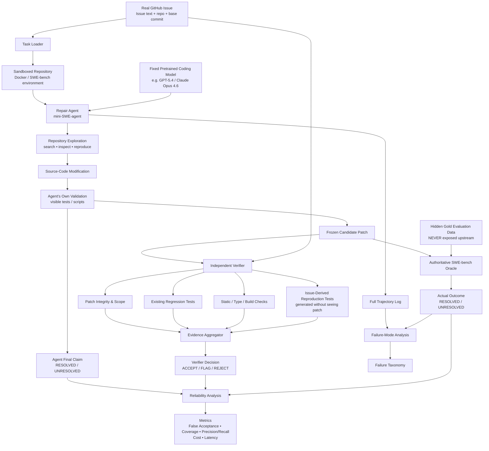

# Execution-Grounded Verification for LLM Software-Repair Agents

## Technical Design Specification

**Student:** Sankalp Rajeev  
**Course:** CIS 695 — Master's Project  
**Semester:** Fall 2026

---

# 1. Technical Objective

Build a reproducible research pipeline that:

1. loads a real repository-level software issue;
2. launches a sandboxed repair agent;
3. lets a fixed pretrained LLM inspect and modify the repository;
4. records the full trajectory and candidate patch;
5. forces the agent to make an explicit resolution claim;
6. freezes the patch;
7. independently verifies the frozen patch without access to benchmark oracle information;
8. produces an `ACCEPT`, `FLAG`, or `REJECT` decision;
9. evaluates the patch using the authoritative benchmark harness;
10. compares agent/verifier decisions against actual resolution.

The main technical contribution is the **verification and reliability measurement pipeline**, not the underlying coding model.

---

# 2. Recommended Technical Decisions

| Component | Recommended default | Reason |
|---|---|---|
| Primary benchmark | SWE-bench Verified | 500 human-reviewed real repository issues |
| Pilot | 10 tasks | Establish cost, environment success, and runtime |
| Final sample | 50–75 tasks | Feasible for a semester; freeze after pilot |
| Agent scaffold | mini-SWE-agent v2 | Minimal, inspectable, benchmark-native |
| Primary model | One strong pretrained API coding model | Avoid model-training scope and obtain enough successful repairs to study reliability |
| Model candidates | GPT-5.4, Claude Opus 4.6; GPT-5.4-mini as cost fallback | Current mini-SWE-agent recommendations |
| Optional open-weight model | Qwen3-Coder-Next | Strong open-weight SWE performance; Apache-2.0 |
| Optional research-trained model | SWE-agent-LM-32B | Public SWE-specific fine-tuned model |
| Fine-tune our own model? | **No** | Confounds verification question; large time/compute cost |
| Fallback benchmark | BugsInPy | Reproducible Python bug infrastructure |
| Harder benchmark | SWE-bench Pro | Stretch only |
| Freshness benchmark | SWE-rebench | Stretch/contamination check |
| Verification mode | Independent, patch-frozen | Isolates verifier from repair generation |
| Gold test access | **Never before oracle evaluation** | Prevents evaluation leakage |

---

# 3. Why We Should Not Fine-Tune the Primary Model

Fine-tuning is technically possible. SWE-smith provides more than 50,000 generated software-engineering tasks and public trajectories, and SWE-agent-LM-32B was created by fine-tuning Qwen2.5-Coder-32B-Instruct on SWE-agent trajectories [6].

However, **we should not fine-tune a model for the required CIS 695 experiment**.

## 3.1 It changes the research question

Current question:

> Can independent verification improve trust in a repair agent?

Fine-tuned question:

> Can we train a better repair agent?

Those are different projects.

## 3.2 It introduces a major confound

If repair accuracy changes after training, we would not know whether a change in false-success behavior came from:

- better localization;
- better coding ability;
- different test behavior;
- altered calibration;
- verification.

## 3.3 It adds unnecessary infrastructure

Fine-tuning would add:

- training-data design;
- trajectory filtering;
- GPU scheduling;
- hyperparameter selection;
- checkpoint management;
- training evaluation;
- model-serving infrastructure.

This could consume a large fraction of the semester.

## 3.4 It increases contamination concerns

SWE-bench-like training data may share repository patterns with evaluation tasks. For a reliability study, the cleanest design is to treat the model as a fixed black-box component.

## 3.5 Better alternative

If model generalization matters, compare:

- one strong general pretrained model;
- one existing open software-engineering model.

Do not train either during the main study.

---

# 4. Model Strategy

## 4.1 Primary model

### Recommended selection rule

Run the 10-task pilot with **one or at most two** currently supported models.

The primary model should have:

- strong repository-level coding ability;
- reliable tool use;
- stable version identifier;
- deterministic/low-temperature mode;
- manageable API cost;
- sufficient context;
- support in mini-SWE-agent.

Current mini-SWE-agent documentation recommends:

- `anthropic/claude-opus-4-6-20260205`
- `openai/gpt-5.4`
- `openai/gpt-5.4-mini` as an OpenAI lower-cost option [3].

### Recommended main-study choice

Use **one strong model** after pilot cost analysis.

A very weak model creates a statistical problem: if almost no patches are ever plausibly successful, there are too few accepted repairs to study false acceptance.

Therefore:

> For the research question, sufficient baseline competence is more important than minimizing per-call cost.

## 4.2 Optional open-weight comparison

### Qwen3-Coder-Next

Qwen3-Coder-Next is available with an Apache-2.0 licence and reports a 70.6% resolved score on SWE-bench Verified under a SWE-Agent harness in its published evaluation metadata [15].

Use only as a stretch condition because:

- running large open-weight coding models locally may require substantial GPU resources;
- different serving stacks create additional experimental variance;
- a second model increases run count and cost.

Hosted inference can be used if local hardware is unavailable, provided the exact endpoint/model revision is recorded.

## 4.3 Optional SWE-specific open model

### SWE-agent-LM-32B

SWE-agent-LM-32B is a 33B-parameter open model produced by fine-tuning Qwen2.5-Coder-32B-Instruct on approximately 5,000 SWE-agent trajectories. Its authors report 40.2% Pass@1 on SWE-bench Verified [6][16].

This is scientifically interesting because it represents a model explicitly trained for software-engineering agent behavior.

It should be a comparator, not something we retrain.

---

# 5. Dataset / Benchmark Landscape

## 5.1 Primary — SWE-bench Verified

**Size:** 500 human-validated tasks [1]  
**Task type:** real GitHub issues + repository state + later human fix/tests  
**Primary language ecosystem:** Python repositories in original SWE-bench lineage  
**Evaluation:** Dockerized patch application + tests  
**Strength:** realistic, widely recognized, strong oracle  
**Risk:** public benchmark contamination; infrastructure/storage complexity  
**Decision:** **Primary benchmark**

## 5.2 SWE-bench Lite

**Size:** 300 tasks [2]  
**Purpose:** cheaper subset  
**Strength:** simpler/lower-cost  
**Weakness:** older curation; Verified is more carefully human-filtered  
**Decision:** useful for debugging only, not preferred final study.

## 5.3 SWE-bench Pro

**Size:** 1,865 problems across 41 repositories [7]  
**Purpose:** longer-horizon, enterprise-like SWE tasks  
**Strength:** harder and more realistic in some dimensions  
**Weakness:** materially heavier environment/evaluation burden; public repo has had ongoing infrastructure fixes  
**Decision:** **stretch only**, potentially 5–10 tasks after core study.

## 5.4 SWE-rebench

**Size:** 21,000+ interactive Python tasks in the published dataset [10]  
**Purpose:** fresher/decontaminated software-agent evaluation  
**Strength:** directly addresses benchmark contamination/staleness  
**Weakness:** newer ecosystem and additional data-pipeline complexity  
**Decision:** optional small freshness check.

## 5.5 SWE-smith

**Size:** 50,000+ generated tasks from 128 repositories [6]  
**Purpose:** training software-engineering agents  
**Strength:** excellent for fine-tuning/RL and controlled training studies  
**Weakness:** generated tasks; not the right primary oracle for our reliability question  
**Decision:** **training resource only; not primary evaluation**.

## 5.6 BugsInPy

**Task type:** reproducible real Python bugs  
**Infrastructure:** buggy/fixed checkout, targeted tests, full tests, coverage, mutation/fuzz tooling [5]  
**Strength:** simpler controlled repair experiments  
**Weakness:** less direct alignment with current coding-agent benchmark ecosystem  
**Decision:** **fallback if SWE-bench environment proves impractical**.

## 5.7 Defects4J

**Current version:** 854 active reproducible Java bugs plus deprecated cases in 3.0.1 [17]  
**Strength:** mature controlled program-repair benchmark  
**Weakness:** Java stack; adds language and tooling shift  
**Decision:** not required; useful future cross-language study.

---

# 6. Final Benchmark Recommendation

## Phase 1 — Engineering pilot

10 SWE-bench Verified tasks.

Purposes:

- validate environment;
- validate model/API;
- estimate cost;
- estimate median runtime;
- ensure trajectory data are complete;
- test agent claim schema;
- test hidden-oracle separation;
- ensure enough agents make `RESOLVED` claims.

## Phase 2 — Main locked subset

Target:

**50–75 SWE-bench Verified tasks**

Exact size is selected **before** main outcomes are inspected, using pilot-derived:

- cost/task;
- time/task;
- environment failure rate;
- compute availability.

## Sampling

Sample across multiple repositories and task styles rather than selecting only trivial issues.

Suggested strata:

- framework/API;
- ORM/database;
- numerical/scientific;
- state/behavior;
- system/runtime.

Do not cherry-pick tasks based on whether the chosen model is known to solve them.

---

# 7. Task Input and Output

## 7.1 Input to repair agent

```yaml
instance_id:
repository:
base_commit:
issue_description:
allowed_workspace:
time_budget:
step_budget:
model:
agent_config:
```

The repair agent may see repository content and visible tests.

It may not see:

```text
gold patch
benchmark test_patch
gold FAIL_TO_PASS tests
oracle result
reference developer solution
```

## 7.2 Repair-agent output

```yaml
instance_id:
patch:
trajectory:
commands:
tests_run:
final_claim: RESOLVED | UNRESOLVED
claim_evidence:
  - command/output reference
duration_seconds:
token_usage:
api_cost:
```

---

# 8. Overall Pipeline Architecture



---

# 9. Important Architecture Principle: Three Independent Layers

The experiment must maintain strict information boundaries.

## Layer A — Repair

Allowed:

- issue;
- base repository;
- existing visible tests;
- commands/tool outputs.

Not allowed:

- gold patch;
- gold acceptance tests.

## Layer B — Verification

Allowed:

- everything Layer A could realistically have;
- frozen candidate patch;
- independently generated reproduction tests.

Not allowed:

- gold patch;
- gold acceptance tests;
- oracle label.

## Layer C — Oracle

Allowed:

- benchmark test patch;
- authoritative FAIL_TO_PASS / PASS_TO_PASS logic;
- gold evaluation environment.

The oracle is the **research label**, not a production component.

---

# 10. Repair Agent Design

## 10.1 Scaffold

**mini-SWE-agent v2** is recommended.

Reasons:

- deliberately small control flow;
- easy to audit;
- direct SWE-bench batch runner;
- Docker support;
- full trajectory output;
- current model-provider support;
- less framework complexity than a large multi-agent system [3].

## 10.2 Why not build our own agent first?

Building an agent would consume time on:

- tool protocol;
- history management;
- shell abstraction;
- patch submission;
- environment plumbing;
- benchmark runner integration.

Those are solved problems.

Our novel engineering should be spent on:

- reliable claim capture;
- independent verification;
- information separation;
- metrics;
- failure analysis.

## 10.3 Required prompt modification

The agent should be instructed to emit an explicit structured final claim.

Example conceptual schema:

```text
FINAL_STATUS: RESOLVED | UNRESOLVED
VALIDATION_EVIDENCE:
- command 1
- result
- command 2
- result
```

The agent cannot use its own confidence adjective as a numeric confidence score.

---

# 11. Independent Verifier

## 11.1 Design goal

The verifier is **not a second repair agent**.

It asks:

> Is there enough independent evidence to trust the frozen patch?

It does not edit production source code in the main experiment.

## 11.2 V1 — Patch integrity

Checks:

- patch applies cleanly;
- no merge/conflict markers;
- no binary artefacts;
- no benchmark/harness modification;
- no deletion/weakening of official project tests;
- no unexpected configuration manipulation;
- source modifications within allowed scope.

Output:

```yaml
integrity: PASS | FAIL
risk_flags: [...]
```

## 11.3 V2 — Existing regression tests

Run the repository's pre-existing tests relevant to the changed area, plus a bounded broader regression set.

Possible selection:

- tests directly named/used by agent;
- tests in same package/module;
- test files referencing modified symbols;
- bounded full suite where runtime permits.

Why:

A patch that fixes one target behavior but breaks old behavior should not be accepted.

## 11.4 V3 — Static/build checks

Repository-dependent checks:

- Python syntax/compile;
- import check;
- linter;
- type checker;
- package build;
- formatter consistency where meaningful.

Unavailable checks are recorded as `NOT_AVAILABLE`, not counted as pass.

## 11.5 V4 — Independently generated reproduction tests

This is the most research-interesting verifier component.

### Inputs

The test generator receives:

- issue description;
- **original buggy repository**;
- relevant source context.

It must **not** receive:

- candidate patch;
- gold patch;
- gold tests.

### Procedure

1. Generate one or more candidate reproduction tests.
2. Run them on the original buggy repository.
3. Keep only tests that:
   - execute deterministically;
   - fail on the buggy base in a way relevant to the issue.
4. Freeze the tests.
5. Run the same tests against the candidate patch.

This reduces direct patch-aware test tailoring.

### Why this matters

Recent research shows that generated tests can themselves overfit and may not reliably predict hidden acceptance tests [8][9].

Therefore, generated tests are not treated as ground truth.

They are one **verification feature** whose actual utility we measure.

## 11.6 V5 — Patch-risk features

Record but do not automatically fail solely because of:

- files changed;
- LOC added/deleted;
- source/test modification ratio;
- unrelated directories touched;
- test deletion;
- assertion weakening;
- broad exception handling;
- API surface changes.

These become interpretable risk features.

---

# 12. Verifier Decision Policy

Start with a transparent rule-based policy.

Example:

```text
REJECT if:
    patch fails to apply
    OR regression test fails
    OR prohibited benchmark/test manipulation detected

ACCEPT if:
    integrity passes
    AND relevant regression checks pass
    AND at least one issue-specific execution signal supports repair
    AND no high-severity risk flags

FLAG otherwise
```

The exact policy is frozen before the final study.

## Why rule-based first?

A learned verifier would require:

- verifier training data;
- calibration split;
- feature engineering;
- risk of overfitting to SWE-bench.

That would become another ML project.

A transparent rule-based verifier is easier to interpret and ablate.

---

# 13. Experimental Conditions

## Condition A — Agent self-assessment

```text
Issue
→ repair agent
→ candidate patch
→ agent own tests
→ agent claim RESOLVED / UNRESOLVED
```

Measure agreement with oracle.

## Condition B — Independent verification

Use the **same frozen patch**:

```text
candidate patch
→ independent verifier
→ ACCEPT / FLAG / REJECT
```

Measure agreement with oracle.

The patch is not regenerated.

This isolates verification quality.

## Optional Condition C — Feedback retry

Only after A/B are complete:

```text
verifier failure evidence
→ repair agent
→ one additional repair attempt
```

This is a different research question and remains stretch scope.

---

# 14. Oracle Evaluation

Use the official SWE-bench evaluation harness.

The harness:

1. creates/loads repository environment;
2. applies the candidate patch;
3. applies/uses benchmark evaluation tests;
4. runs required tests;
5. outputs resolution result [2].

Important:

The oracle's test information is **not copied back into agent or verifier inputs**.

---

# 15. Metrics

## 15.1 Base false-success rate

For tasks where the agent claims `RESOLVED`:

\[
FSR_{agent} =
\frac{
\#(\text{Agent claims RESOLVED and oracle = UNRESOLVED})
}{
\#(\text{Agent claims RESOLVED})
}
\]

## 15.2 Verifier false-acceptance rate

\[
FAR_{verifier} =
\frac{
\#(\text{Verifier ACCEPT and oracle = UNRESOLVED})
}{
\#(\text{Verifier ACCEPT})
}
\]

## 15.3 Acceptance coverage

\[
Coverage =
\frac{\#(\text{Verifier ACCEPT})}{\#(\text{valid patches})}
\]

This is essential.

A verifier that rejects every patch has 0% false acceptance but is useless.

## 15.4 Other metrics

- oracle resolution rate;
- verifier acceptance precision;
- verifier acceptance recall;
- false-rejection rate;
- regression detection rate;
- fraction flagged;
- mean/median latency;
- model tokens;
- API cost;
- verifier CPU time;
- files changed;
- lines changed.

## 15.5 Reliability–coverage curve

If the verifier produces a numeric evidence score, vary threshold and plot:

```text
x-axis: accepted fraction
y-axis: false-acceptance rate / acceptance precision
```

This is more informative than one operating point.

---

# 16. Failure Taxonomy

Candidate categories:

1. **Issue misunderstanding**
2. **Wrong file/symbol localization**
3. **Incomplete semantic repair**
4. **Correct target change + regression elsewhere**
5. **Test overfitting**
6. **Premature success declaration**
7. **Environment/tool failure**
8. **Patch application failure**
9. **Risky test/config manipulation**
10. **Verifier false rejection**
11. **Generated-test failure / invalid surrogate**
12. **Oracle/infrastructure anomaly**

Multiple labels may be assigned.

---

# 17. Example Task Flow

Consider a real-style framework issue:

> A database constraint behaves incorrectly only when logical `OR` and `AND` clauses are combined on specific backends.

## Repair agent

1. Reads issue.
2. Searches Django constraint compiler.
3. Reads backend SQL generation.
4. Writes a reproduction snippet.
5. Edits compiler logic.
6. Runs targeted local tests.
7. Claims `RESOLVED`.
8. Submits patch.

## Independent verifier

1. Confirms patch did not edit benchmark/tests.
2. Runs affected Django test module.
3. Runs related schema/constraint regression tests.
4. Generates an independent issue-derived check from original code.
5. Confirms generated reproduction fails on base.
6. Runs reproduction on patch.
7. Checks patch scope.
8. Outputs `ACCEPT`.

## Oracle

Official hidden benchmark tests run.

Possible result:

```text
Agent: RESOLVED
Verifier: ACCEPT
Oracle: UNRESOLVED
```

This becomes a false acceptance and is analyzed:

- Did generated test cover only SQLite but not Oracle?
- Did existing test selection miss a backend-specific path?
- Was issue interpretation incomplete?

That failure is exactly the research signal.

---

# 18. Data Schemas

## 18.1 Repair record

```yaml
task_id:
repo:
base_commit:
model_id:
agent_version:
config_hash:
start_time:
duration_s:
agent_claim:
patch_path:
trajectory_path:
commands_run:
tests_run:
tokens_in:
tokens_out:
api_cost_usd:
```

## 18.2 Verification record

```yaml
task_id:
patch_integrity:
regression:
  status:
  tests_run:
  failures:
static_checks:
  status:
  tools:
reproduction_tests:
  generated:
  valid_fail_on_base:
  pass_on_patch:
risk_flags:
decision: ACCEPT | FLAG | REJECT
verification_time_s:
```

## 18.3 Oracle record

```yaml
task_id:
evaluation_completed:
resolved:
fail_to_pass:
pass_to_pass:
infrastructure_error:
```

---

# 19. Repository Architecture

```text
cis695-agent-reliability/
├── README.md
├── pyproject.toml
├── uv.lock
├── Dockerfile
├── configs/
│   ├── agent/
│   ├── model/
│   ├── verifier/
│   └── experiments/
├── manifests/
│   ├── pilot.csv
│   └── main_frozen.csv
├── src/
│   └── reliability/
│       ├── benchmark/
│       │   ├── loader.py
│       │   ├── sandbox.py
│       │   └── oracle.py
│       ├── agent/
│       │   ├── runner.py
│       │   └── claim_parser.py
│       ├── verifier/
│       │   ├── integrity.py
│       │   ├── regression.py
│       │   ├── static_checks.py
│       │   ├── reproduction_tests.py
│       │   └── decision.py
│       ├── analysis/
│       │   ├── metrics.py
│       │   ├── statistics.py
│       │   └── failure_taxonomy.py
│       └── reporting/
├── tests/
│   ├── unit/
│   ├── integration/
│   └── golden/
├── runs/
├── reports/
│   ├── figures/
│   ├── tables/
│   └── cases/
└── docs/
    ├── PROJECT_OVERVIEW.md
    └── TECHNICAL_DESIGN.md
```

---

# 20. Execution Stages

## Stage 0 — feasibility

- install Docker + SWE-bench;
- run official evaluation on known predictions;
- ensure environments work.

## Stage 1 — agent pilot

- integrate mini-SWE-agent;
- select model;
- run 10 tasks;
- measure cost/runtime;
- validate final-claim capture.

## Stage 2 — verifier MVP

Implement:

- integrity;
- regression;
- static checks;
- decision schema.

## Stage 3 — independent reproduction testing

Implement issue-derived test generation with strict no-patch visibility.

## Stage 4 — freeze

Freeze:

- model;
- prompt/config;
- task manifest;
- verifier policy;
- metrics.

## Stage 5 — main patch generation

Generate patches once.

## Stage 6 — verification

Run verifier against frozen patches.

## Stage 7 — oracle

Evaluate frozen patches with official harness.

## Stage 8 — analysis

Compare:

```text
agent claim ↔ oracle
verifier decision ↔ oracle
```

and perform ablations/failure analysis.

---

# 21. Verification Ablations

The final report should not only evaluate the complete verifier.

Ablations:

| Configuration | Integrity | Regression | Static | Generated reproduction |
|---|---:|---:|---:|---:|
| A | ✓ | | | |
| B | ✓ | ✓ | | |
| C | ✓ | ✓ | ✓ | |
| D | ✓ | | | ✓ |
| Full | ✓ | ✓ | ✓ | ✓ |

Question:

> Which signal provides the largest reduction in false acceptance for the least added cost?

---

# 22. Generated-Test Research Design

Because recent literature questions the reliability of generated tests, test generation must be handled carefully [8][9].

## Test generator information

Allowed:

- issue description;
- original code;
- repository docs;
- pre-existing tests.

Forbidden:

- candidate patch;
- gold patch;
- gold test patch;
- oracle result.

## Valid-test gate

A generated test is accepted as a verifier feature only if:

1. it parses;
2. it runs;
3. it fails on the buggy base;
4. failure is stable over repeated runs;
5. failure is semantically related to issue.

It is then frozen and executed on the candidate patch.

## Important interpretation

A generated test passing does **not** mean the patch is correct.

It means:

> the patch satisfies one independently constructed observable property.

The oracle remains authoritative.

---

# 23. Statistical Plan

For the final locked task set:

- report task counts;
- report infrastructure failures separately;
- compute 95% bootstrap confidence intervals;
- use paired analysis because agent and verifier decisions share the same patch;
- consider McNemar's test for paired binary acceptance errors;
- report effect size, not only significance;
- avoid claims from tiny repository subgroups.

Primary comparison:

\[
FSR_{agent} \quad \text{vs.} \quad FAR_{verifier}
\]

with acceptance coverage reported beside it.

---

# 24. Reproducibility

Every run must store:

```yaml
task_manifest_hash:
git_commit:
agent_version:
model_exact_id:
temperature:
step_limit:
token_limit:
timeout:
verifier_version:
docker_image:
timestamp:
```

Expensive LLM calls should not be required to reproduce analysis.

Primary tables must regenerate from:

- stored trajectories;
- stored patches;
- verifier records;
- oracle records.

---

# 25. Security

The repair agent executes generated shell commands.

Required:

- Docker sandbox;
- no host SSH mount;
- no cloud credentials inside container;
- no personal home-directory mount;
- per-task timeout;
- disk and process limits where practical;
- record shell commands;
- no unrestricted agent execution on host OS.

---

# 26. Decision Gates

## Gate 1 — benchmark

If SWE-bench infrastructure is not stable enough during pilot:

> switch to BugsInPy before main-study freeze.

## Gate 2 — model

If chosen model produces almost no plausible repairs:

> move to stronger model before freeze.

Do not change after main study begins.

## Gate 3 — generated tests

If reproduction-test generation is too unreliable:

> preserve integrity + regression + static verification as core; report generated tests as failed/limited research component.

## Gate 4 — second model

Only add second model if:

- main experiment complete;
- report draft on schedule;
- compute/budget available.

---

# 27. Final Recommended Configuration

```yaml
benchmark:
  primary: SWE-bench Verified
  pilot_tasks: 10
  main_tasks_target: 50-75
  fallback: BugsInPy

agent:
  scaffold: mini-SWE-agent v2
  primary_model: select after pilot
  candidates:
    - GPT-5.4
    - Claude Opus 4.6
    - GPT-5.4-mini
  temperature: low/deterministic where supported
  fine_tune: false

open_weight_stretch:
  preferred: Qwen3-Coder-Next
  alternative: SWE-agent-LM-32B

verifier:
  patch_integrity: required
  regression_tests: required
  static_checks: required_when_available
  independent_reproduction_tests: target
  candidate_patch_visible_to_test_generator: false
  gold_tests_visible: false
  gold_patch_visible: false

outcomes:
  agent_claim:
    - RESOLVED
    - UNRESOLVED
  verifier_decision:
    - ACCEPT
    - FLAG
    - REJECT
  oracle:
    - RESOLVED
    - UNRESOLVED

primary_metric:
  false_acceptance_rate

paired_metric:
  acceptance_coverage
```

---

# 28. References / Technical Research Basis

[1] SWE-bench Verified.  
https://www.swebench.com/verified.html

[2] SWE-bench FAQ, datasets, and evaluation.  
https://www.swebench.com/SWE-bench/faq/  
https://www.swebench.com/SWE-bench/guides/datasets/  
https://www.swebench.com/SWE-bench/guides/quickstart/

[3] mini-SWE-agent documentation and SWE-bench runner.  
https://mini-swe-agent.com/latest/  
https://mini-swe-agent.com/latest/usage/swebench/  
https://mini-swe-agent.com/latest/quickstart/

[4] Xia et al., *Agentless: Demystifying LLM-based Software Engineering Agents*, 2024.  
https://arxiv.org/abs/2407.01489

[5] BugsInPy.  
https://github.com/soarsmu/BugsInPy

[6] Yang et al., *SWE-smith: Scaling Data for Software Engineering Agents*, NeurIPS 2025.  
https://arxiv.org/abs/2504.21798  
https://swesmith.com/

[7] Deng et al., *SWE-Bench Pro: Can AI Agents Solve Long-Horizon Software Engineering Tasks?*, 2025.  
https://arxiv.org/abs/2509.16941

[8] Ahmed et al., *Investigating Test Overfitting on SWE-bench / Is the Cure Still Worse Than the Disease?*, FSE 2026.  
https://arxiv.org/abs/2511.16858

[9] Chen et al., *Rethinking the Value of Agent-Generated Tests for LLM-Based Software Engineering Agents*, 2026.  
https://arxiv.org/abs/2602.07900

[10] Badertdinov et al., *SWE-rebench: An Automated Pipeline for Task Collection and Decontaminated Evaluation of Software Engineering Agents*, 2025.  
https://arxiv.org/abs/2505.20411

[11] Lou et al., *When Automated Program Repair Meets Regression Testing — An Extensive Study on 2 Million Patches*, 2021.  
https://arxiv.org/abs/2105.07311

[12] SWE-bench official evaluation format and harness notes.  
https://github.com/SWE-bench/SWE-bench/blob/main/docs/assets/evaluation.md

[13] SWE-bench Verified task registry / representative tasks.  
https://www.tbench.ai/registry/swebench-verified/head

[14] SWE-bench Pro open-source repository.  
https://github.com/scaleapi/SWE-bench_Pro-os

[15] Qwen3-Coder-Next model and reported evaluation metadata.  
https://huggingface.co/Qwen/Qwen3-Coder-Next

[16] SWE-agent-LM-32B model card.  
https://huggingface.co/SWE-bench/SWE-agent-LM-32B

[17] Defects4J 3.0.1.  
https://github.com/rjust/defects4j
