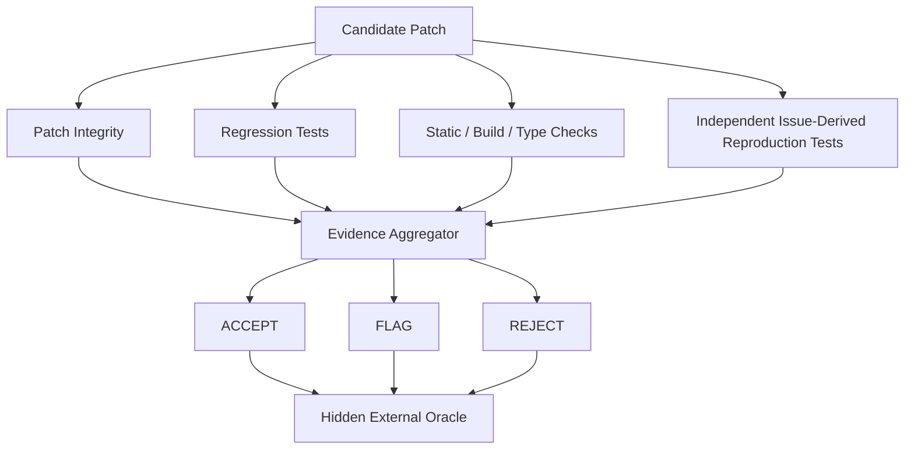

# Literature Review: Reliability and Verification of LLM-Based Automated Software Repair

## 1. Introduction

Large-language-model software agents can now inspect repositories, reason over issue descriptions, execute shell commands, modify source code, run tests, and submit patches for real software defects. Benchmarks such as SWE-bench have made repository-level repair measurable, while systems such as SWE-agent, Agentless, mini-SWE-agent, and newer software-engineering agents have demonstrated that LLMs can solve a meaningful fraction of real GitHub issues.

However, successful patch generation and trustworthy repair are not the same problem.

A repair agent may produce a patch that appears plausible, compiles successfully, passes a small set of tests, satisfies a generated reproduction test, or causes the agent to terminate with a “resolved” state while still failing the actual issue requirements, introducing regressions, overfitting to visible tests, or behaving differently from the human developer fix.

This review examines prior work across four related areas:

1. repository-level LLM software repair;
2. patch validation and test-based correctness assessment;
3. semantic and reasoning-based patch verification;
4. reliability, false confidence, and benchmark limitations.

The objective is to identify what has already been established and define a defensible research gap for a CIS 695 Master's Project on **execution-grounded selective verification of LLM-generated software repairs**.

---

## 2. Repository-Level LLM Software Repair

### 2.1 SWE-agent

SWE-agent introduced a software-engineering agent interface that allows an LLM to interact with a repository through a structured command environment. The agent can search code, inspect files, modify source code, execute tests, and produce patches for real GitHub issues.

Its main contribution is agentic repository interaction rather than independent verification.

**Relevance to this project:** SWE-agent establishes that LLMs can act as autonomous software-maintenance agents.

**Limitation relative to this project:** Its primary evaluation objective is whether issues are successfully resolved. It does not focus on whether the agent's **own success declaration is trustworthy before authoritative evaluation is known**.

**Reference:**  
SWE-agent: Agent-Computer Interfaces Enable Automated Software Engineering.  
https://arxiv.org/abs/2405.15793

### 2.2 Agentless

Agentless proposed a simpler alternative to complex software-engineering agents. Instead of maintaining a long autonomous trajectory, it separates the workflow into stages such as fault localization, repair generation, and patch validation.

Agentless uses execution and validation mechanisms to filter poor candidate patches and improve final issue-resolution performance.

**Relevance:** Agentless demonstrates that patch validation is already recognized as an important part of LLM-based repair.

**Limitation:** Patch validation is primarily used as a **candidate-selection mechanism** to improve solve rate. The research question remains:

> Among patches a system is willing to accept, how many are actually incorrect?

This requires studying validation as a **trust gate**, not only as a patch-ranking component.

**Reference:**  
Xia et al., *Agentless: Demystifying LLM-based Software Engineering Agents*, 2024.  
https://arxiv.org/abs/2407.01489

### 2.3 mini-SWE-agent

mini-SWE-agent provides a deliberately minimal software-repair agent architecture designed for reproducibility and SWE-bench experimentation.

It supports:

- containerized repository execution;
- multiple model providers;
- trajectory capture;
- SWE-bench batch evaluation;
- relatively small and inspectable control logic.

**Relevance:** mini-SWE-agent is attractive for this project because it allows the repair agent to remain a fixed infrastructure component rather than becoming the research contribution.

**Limitation:** Like other repair agents, its primary purpose is issue resolution rather than selective trust estimation.

**Reference:**  
https://mini-swe-agent.com/latest/

---

## 3. SWE-bench and Repository-Level Evaluation

### 3.1 SWE-bench

SWE-bench evaluates software-repair systems using real GitHub issues. A task typically contains an issue description, repository, base commit, and later developer patch/tests used for evaluation.

A system receives the issue and buggy repository state, then produces a patch. The benchmark harness applies the patch in an isolated environment and evaluates whether the issue is resolved.

**Relevance:** SWE-bench provides the authoritative execution-based oracle required for this project.

**Reference:**  
https://www.swebench.com/

### 3.2 SWE-bench Verified

SWE-bench Verified contains 500 human-reviewed SWE-bench tasks selected for clearer problem statements and more reliable evaluation.

**Relevance:** This is the preferred benchmark for the project because it reduces ambiguity in the underlying tasks and test criteria.

**Limitation:** Although Verified improves benchmark quality, later research shows that benchmark test passing itself should not automatically be equated with complete semantic correctness.

**Reference:**  
https://www.swebench.com/verified.html

---

## 4. The Patch Overfitting Problem

The idea that passing tests does not guarantee patch correctness predates LLM software agents.

Classical Automated Program Repair research established a distinction between:

- **plausible patches** — patches that pass available tests;
- **correct patches** — patches that implement the intended behavior.

A patch can overfit an incomplete test suite.

This remains highly relevant to modern LLM repair systems.

### 4.1 Automated Patch Assessment

Prior work on automated patch assessment examined whether generated tests and behavioral analysis can distinguish correct patches from plausible-but-incorrect patches.

**Relevance:** This establishes that **patch correctness assessment is not a new research problem**.

**Gap:** Modern repository-level LLM agents introduce new dimensions:

- long interactive trajectories;
- natural-language reasoning;
- tool use;
- self-generated tests;
- autonomous success declarations;
- patch acceptance decisions.

The question becomes not simply:

> Is this patch correct?

but:

> Can an autonomous repair system know when its own evidence is sufficient to trust the patch?

**Reference:**  
Automated Patch Assessment at Scale.  
https://link.springer.com/article/10.1007/s10664-020-09920-w

---

## 5. Generated Tests for Software Repair

### 5.1 e-Otter++

e-Otter++ focuses on generating reproduction tests from natural-language issue descriptions. The system attempts to construct tests that reproduce the issue, providing an executable signal for software repair.

**Relevance:** Issue-derived reproduction tests are an important candidate verification signal.

**Limitation:** A generated test is itself imperfect. Passing a generated reproduction test does not prove that the complete issue has been fixed, unrelated behavior remains correct, or the generated test captures the intended semantics.

**Reference:**  
https://arxiv.org/abs/2508.06365

### 5.2 Test Overfitting on SWE-bench

A 2026 study directly investigated test overfitting in repository-level LLM software repair.

It found that patches which passed generated tests could still fail hidden acceptance or regression tests. Reported overfitting rates among patches passing generated tests included approximately:

- 21.8% in one Claude-based setup;
- 33.0% in one GPT-4o-based setup.

**Importance:** This provides strong empirical evidence that:

> **Generated tests are useful evidence, but they should not be treated as a correctness oracle.**

**Implication for this project:** Generated reproduction tests should be only one component of a broader verification system. They should also be generated independently of the candidate patch where possible.

**Reference:**  
Ahmed et al., *Investigating Test Overfitting on SWE-bench / Is the Cure Still Worse Than the Disease?*, FSE 2026.  
https://arxiv.org/abs/2511.16858

### 5.3 Rethinking Agent-Generated Tests

Another 2026 empirical study examined test-writing behavior across multiple LLM-based software-engineering agents.

The work found that simply increasing or decreasing how much testing agents performed did not consistently improve final issue-resolution outcomes.

**Relevance:** This suggests that the solution is not merely:

> “Make the agent write more tests.”

Instead, the project should investigate which verification signals provide useful evidence, whether those signals are independent, and how they affect false acceptance and coverage.

**Reference:**  
Chen et al., *Rethinking the Value of Agent-Generated Tests for LLM-Based Software Engineering Agents*, 2026.  
https://arxiv.org/abs/2602.07900

---

## 6. Test-Suite Discrimination and Mutation-Based Evaluation

### 6.1 SWE-Mutation

SWE-Mutation studies whether generated test suites can distinguish correct implementations from realistic incorrect ones.

The central problem is not merely test execution but **test discriminative power**.

**Relevance:** A test may execute successfully and still fail to distinguish a subtly incorrect patch from a correct one.

**Implication:** Verification should not assume:

```text
generated test passes
→ patch is correct
```

Instead:

```text
generated test passes
→ one additional piece of evidence supports the patch
```

**Reference:**  
*SWE-Mutation*, ACL Findings 2026.  
https://aclanthology.org/2026.findings-acl.1976/

---

## 7. Benchmark Correctness and Oracle Limitations

### 7.1 PatchDiff / “Are Solved Issues in SWE-bench Really Solved Correctly?”

A 2026 empirical study investigated whether patches counted as solved by SWE-bench actually matched developer-intended behavior.

The authors reported that some patches passing benchmark tests failed additional developer-written tests and that some plausible patches exhibited behavioral divergence from the human fix.

**Relevance:** This introduces an important distinction:

```text
Agent believes patch works
        ↓
Generated tests believe patch works
        ↓
SWE-bench oracle says patch works
        ↓
Actual intended behavior may still differ
```

**Implication:** For this Master's Project, the official benchmark oracle remains the operational ground truth because a tractable experiment needs a defined label. However, the final report must explicitly state:

> SWE-bench resolution is an execution-based benchmark oracle, not absolute proof of real-world semantic correctness.

**Reference:**  
ICSE 2026 research track:  
*Are Solved Issues in SWE-bench Really Solved Correctly? An Empirical Study*  
https://conf.researchr.org/details/icse-2026/icse-2026-research-track/59/Are-Solved-Issues-in-SWE-bench-Really-Solved-Correctly-An-Empirical-Study

---

## 8. Semantic and Reasoning-Based Patch Verification

### 8.1 Patch Reasoner / R4P

Patch Reasoner approaches patch correctness as a reasoning problem. A model examines the issue and proposed patch and predicts whether the repair is correct.

**Relevance:** This demonstrates that patch verification can be treated as a distinct task from patch generation.

**Limitation relative to this project:** The verifier is primarily reasoning/model-based rather than execution-grounded.

This raises a complementary research question:

> Can execution evidence provide a more reliable or complementary trust signal?

**Reference:**  
https://arxiv.org/abs/2510.22775

### 8.2 LLM-as-a-Judge Patch Evaluation

Recent work has explored using LLM judges, sometimes together with human-defined evaluation criteria, to determine whether patches satisfy requirements.

**Relevance:** This demonstrates interest in automated post-generation patch assessment.

**Limitation:** Such approaches may require human-created rubrics, reference information, an additional LLM, or semantic judgment without actual execution.

For deployment-oriented verification, execution signals may provide a different and more auditable form of evidence.

**Reference:**  
Google Research, *Towards a Human-in-the-Loop Framework for Reliable Patch Evaluation Using an LLM as a Judge*  
https://research.google/pubs/towards-a-human-in-the-loop-framework-for-reliable-patch-evaluation-using-an-llm-as-a-judge/

---

## 9. RETRACE: Closest Recent Work

### 9.1 Overview

RETRACE, released in August 2026, is particularly close to the proposed project.

It argues that coding agents lack an independent signal for determining whether a generated patch actually solves the reported problem.

Its method performs semantic reconstruction.

#### Forward reconstruction

```text
Issue + trajectory
→ infer/reconstruct what problem the agent believes it is solving
```

#### Backward reconstruction

```text
Patch + trajectory
→ infer what problem the patch appears to solve
```

The two reconstructions are compared.

If they disagree, RETRACE identifies likely reasoning or implementation errors and can send revision feedback to the repair agent.

### 9.2 Importance

RETRACE means the project cannot claim:

> “Independent verification of LLM-generated patches has not been studied.”

That would be incorrect.

**Reference:**  
RETRACE, August 2026.  
https://arxiv.org/abs/2608.08950

---

## 10. Gap After RETRACE

RETRACE makes the remaining research gap more specific.

### 10.1 Semantic/reasoning-based vs execution-grounded verification

RETRACE asks:

> Does the patch semantically appear to solve the same problem described by the issue?

The proposed project instead asks:

> Is there enough **execution-grounded evidence** to trust the patch?

Conceptually:

```text
RETRACE
Patch
  ↓
LLM semantic reconstruction
  ↓
Does this patch appear to solve the same problem?


PROPOSED PROJECT
Patch
  ↓
Independent execution evidence
  ├── existing regression tests
  ├── issue-derived reproduction tests
  ├── build/static/type checks
  ├── patch integrity
  └── patch-risk signals
  ↓
Do we have enough evidence to TRUST this patch?
```

### 10.2 Repair-rate optimization vs selective trust

Much prior work evaluates:

- Pass@1;
- resolved-task rate;
- patch ranking;
- repair improvement.

For practical deployment, a different metric matters:

> **Of the patches the system accepted, how many were actually wrong?**

Define:

\[
\text{False Acceptance Rate}
=
\frac{
\text{Accepted patches that fail authoritative evaluation}
}{
\text{All accepted patches}
}
\]

This must be paired with:

\[
\text{Coverage}
=
\frac{
\text{Accepted patches}
}{
\text{All candidate patches}
}
\]

A verifier that rejects everything has zero false acceptance but zero practical value.

Therefore, the research object becomes a **risk–coverage trade-off**.

---

## 11. Multi-Signal Verification Gap

Existing literature has independently studied:

- regression tests;
- issue-derived tests;
- generated tests;
- mutation testing;
- LLM patch judges;
- semantic verification;
- patch filtering;
- static checking.

A less explored question is:

> **How should multiple independent verification signals be combined into a selective acceptance layer for autonomous LLM repair?**

A proposed verifier could combine:



The final experiment can then measure which signals contribute useful information.

---

## 12. Proposed Verification Ablation Gap

The project can evaluate:

| Configuration | Purpose |
|---|---|
| Regression only | Measure value of existing tests |
| Reproduction tests only | Measure value of issue-derived execution |
| Static/build only | Measure simple engineering validation |
| Regression + reproduction | Test complementary evidence |
| Full verifier | Measure combined trust performance |
| Semantic verifier, optional | Compare reasoning vs execution |

This turns verification into an empirical study rather than an engineering feature.

---

## 13. Independence of Generated Tests

Recent test-overfitting work suggests generated tests should not be tailored to the candidate patch.

A cleaner design is:

```text
Issue description
+
Original buggy repository
        ↓
Independent test generator
        ↓
Generated reproduction test
```

The generator should not see:

- candidate patch;
- developer/gold patch;
- hidden test patch;
- final benchmark result.

Then:

```text
Buggy repository
→ reproduction test should fail

Candidate patch
→ same frozen test should pass
```

This creates a more independent verification signal.

The generated test still does not become ground truth.

---

## 14. Reasoning Verification vs Execution Verification

Recent work allows a stronger research framing.

### 14.1 Semantic/reasoning verification

Examples:

- Patch Reasoner;
- RETRACE;
- LLM-as-a-judge.

Concept:

```text
Issue + Patch
→ reason about semantic consistency
→ predict correctness
```

### 14.2 Execution-grounded verification

Proposed project:

```text
Issue + Original Repository + Candidate Patch
        ↓
Independent executable evidence
        ↓
Regression / reproduction / build / static checks
        ↓
Accept / Flag / Reject
```

### 14.3 Hybrid verification

Optional stretch direction:

```text
Semantic reasoning
+
Execution evidence
        ↓
Combined selective verifier
```

This motivates an especially strong research question:

> **How does execution-grounded patch verification compare with semantic/reasoning-based verification for determining whether LLM-generated software repairs should be trusted?**

---

## 15. Final Research Gap

The literature supports the following defensible gap:

> Prior work has significantly improved repository-level software repair through agentic tool use, patch ranking, regression filtering, reproduction-test generation, semantic patch verification, and post-generation reasoning. At the same time, recent studies show that generated tests can be overfit, agent-written testing does not necessarily improve final outcomes, and even benchmark-resolved patches may diverge from intended behavior. Independent semantic verification has only recently emerged through methods such as RETRACE. A remaining practical question is whether a lightweight, oracle-blind, execution-grounded verifier can act as a selective trust layer for frozen LLM-generated patches, and which verification signals provide the best reliability–coverage trade-off.

---

## 16. Proposed Research Questions

### RQ1 — Agent self-reliability

**How often does an LLM software-repair agent declare success when authoritative execution-based evaluation later shows the patch is incorrect?**

### RQ2 — Execution-grounded verification

**Can an independent execution-grounded verifier reduce false acceptance of incorrect LLM-generated patches?**

### RQ3 — Verification signals

**Which verification components contribute most to reliable acceptance decisions?**

Candidate components:

- patch integrity;
- regression tests;
- static/build checks;
- independently generated reproduction tests.

### RQ4 — Risk–coverage trade-off

**How does stricter verification affect both false-acceptance rate and the fraction of patches that can be automatically accepted?**

### RQ5 — Failure modes

**Which agent failure types remain difficult to detect using execution-grounded verification?**

### RQ6 — Optional comparison

**Does combining semantic reasoning with execution evidence outperform either verification approach alone?**

---

## 17. Proposed Project Positioning

### Working title

**Trust but Verify: Execution-Grounded Selective Validation of LLM-Generated Software Repairs**

### Proposed contribution statement

> This project will empirically evaluate whether oracle-blind execution evidence can identify which autonomous software repairs are safe to accept, using false-acceptance versus coverage rather than repair rate alone as the primary reliability perspective.

The project is not intended to claim that automated patch validation, generated tests, independent patch verification, or SWE-bench repair are new.

The contribution is the **selective reliability framing**, **strict separation between repair, verification, and oracle**, and **controlled evaluation of multiple execution-grounded trust signals for frozen LLM-generated patches**.

---

## 18. Literature Summary Table

| Work | Main focus | Verification type | Primary objective | Remaining gap |
|---|---|---|---|---|
| SWE-agent | Agentic repository repair | Agent self-testing | Resolve issues | No selective trust analysis |
| Agentless | Localization + repair + validation | Regression/filtering | Improve resolve rate | Validation not studied as acceptance policy |
| Classical APR patch assessment | Plausible vs correct patches | Generated/external tests | Detect overfit patches | Pre-agent setting |
| e-Otter++ | Issue-derived test generation | Generated tests | Reproduce bug | Test != patch correctness |
| Test Overfitting on SWE-bench | Overfitting analysis | Hidden tests | Measure test weakness | Does not build general trust gate |
| Rethinking Agent Tests | Agent testing behavior | Agent tests | Evaluate impact of test writing | No multi-signal verifier |
| SWE-Mutation | Test discrimination | Mutation-based | Evaluate generated tests | Not patch acceptance architecture |
| PatchDiff | Benchmark oracle quality | Behavioral comparison | Audit SWE-bench resolution | Not pre-merge verifier |
| Patch Reasoner / R4P | Patch correctness prediction | Semantic reasoning | Classify correct patches | Limited execution grounding |
| LLM-as-a-Judge | Automated patch assessment | Semantic/judge | Estimate validity | Requires judge/rubric |
| RETRACE | Independent semantic verification | Forward/backward reconstruction | Improve repair reliability and Pass@1 | No execution-grounded selective acceptance |
| **Proposed project** | Selective trust of frozen patches | Multi-signal execution evidence | Minimize false acceptance at useful coverage | Target gap |

---

## 19. References

1. SWE-agent: Agent-Computer Interfaces Enable Automated Software Engineering.  
   https://arxiv.org/abs/2405.15793

2. Xia et al., *Agentless: Demystifying LLM-based Software Engineering Agents*, 2024.  
   https://arxiv.org/abs/2407.01489

3. mini-SWE-agent.  
   https://mini-swe-agent.com/latest/

4. SWE-bench.  
   https://www.swebench.com/

5. SWE-bench Verified.  
   https://www.swebench.com/verified.html

6. Automated Patch Assessment at Scale.  
   https://link.springer.com/article/10.1007/s10664-020-09920-w

7. e-Otter++.  
   https://arxiv.org/abs/2508.06365

8. Ahmed et al., *Investigating Test Overfitting on SWE-bench / Is the Cure Still Worse Than the Disease?*, FSE 2026.  
   https://arxiv.org/abs/2511.16858

9. Chen et al., *Rethinking the Value of Agent-Generated Tests for LLM-Based Software Engineering Agents*, 2026.  
   https://arxiv.org/abs/2602.07900

10. *SWE-Mutation*, ACL Findings 2026.  
    https://aclanthology.org/2026.findings-acl.1976/

11. *Are Solved Issues in SWE-bench Really Solved Correctly? An Empirical Study*, ICSE 2026.  
    https://conf.researchr.org/details/icse-2026/icse-2026-research-track/59/Are-Solved-Issues-in-SWE-bench-Really-Solved-Correctly-An-Empirical-Study

12. Patch Reasoner / R4P.  
    https://arxiv.org/abs/2510.22775

13. Google Research, *Towards a Human-in-the-Loop Framework for Reliable Patch Evaluation Using an LLM as a Judge*.  
    https://research.google/pubs/towards-a-human-in-the-loop-framework-for-reliable-patch-evaluation-using-an-llm-as-a-judge/

14. RETRACE, 2026.  
    https://arxiv.org/abs/2608.08950
