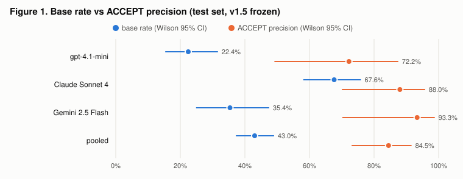
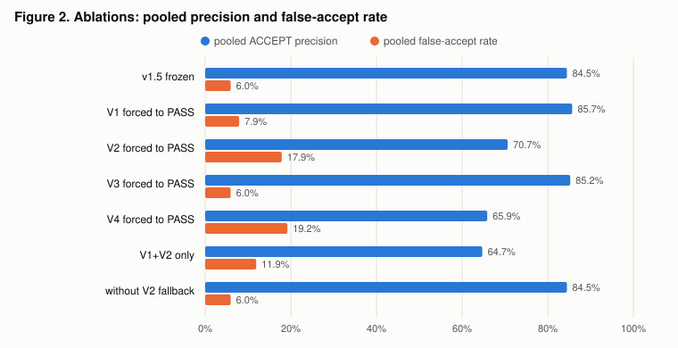

# Trust but Verify: Execution-Grounded Verification of LLM-Generated Software Repairs

Sankalp Rajeev · advisor Dr. Foyzul Hassan · CIS 695, University of Michigan–Dearborn, Fall 2026

25 November 2026 · built from commit `5ea95a747053` · verifier tag `v1.5-frozen-2` (`26d42df0fd70`) · analysis tag `study-analysis-frozen` (`8f0979253359`)

*Generated by `scripts/build_report_v1_5.py` from `reports/study_v1_5/report_template.md` and the result files in [results/](results/). Do not edit by hand.*

## 1. Summary

- **Question.** When should a developer believe a coding agent's claim that its patch fixes an issue? We test whether an oracle-blind verifier that runs the patch can tell correct patches from wrong ones well enough that its ACCEPT is worth more than the agent's word.
- **Setup.** A frozen verifier (v1.5: patch integrity, regression tests, static checks and issue-derived reproduction tests, combined by fixed rules into ACCEPT, FLAG or REJECT) judged the public SWE-bench Verified patches of three agents (gpt-4.1-mini, Claude Sonnet 4 and Gemini 2.5 Flash, all mini-SWE-agent) on 108 held-out tasks, plus the gold patches. Correctness labels came from the SWE-bench grader only after each run was sealed. Rules, switches, analysis code and hypotheses were all fixed before any label was opened.
- **Headline.** Pooled ACCEPT precision is 84.5% [73.1%, 91.6%] against a base rate of 43.0% [37.2%, 49.0%] (n = 265 labelled non-empty patches). H1 (precision − base rate) 95% CI [30.9%, 51.7%], supported; H2 (held-back difference) 95% CI [25.3%, 48.6%], supported. H3: 1 of 108 gold REJECTed, Wilson upper bound 5.1%. Batch 2 alone, held out from everything that shaped the analysis, gives 93.1% [78.0%, 98.1%] against 45.8% [37.0%, 54.7%].
- **Ablations.** V2 (regression tests) and V4 (reproduction tests) carry the verifier: forcing either to PASS raises the false-accept rate from 6.0% to 17.9% (V2) and 19.2% (V4). V3 adds nothing measurable here, and V1 costs the most coverage.
- **Gold ceiling.** v1.5 ACCEPTs 69/108 = 63.9% [54.5%, 72.3%] of gold patches. Superseded assertions and issues that cannot be reproduced as a test, the limit of any oracle-blind verifier, account for 11.1% of all gold patches; V4 tests that assert the wrong thing and V2 runs that produce no result, both fixable, account for 25.0%.

## 2. Questions and hypotheses

From [PROTOCOL.md](PROTOCOL.md) §6 (tag `study-v1.5-prereg`), with amendments [A](AMENDMENT_2026-11-21.md) and [B](AMENDMENT_2026-11-21b.md).

- **RQ1 Agent reliability.** How often is a submitted (non-empty) agent patch correct, and how often do agents submit nothing?
- **RQ2 Verification value.** Is an ACCEPT more reliable than the base rate, per system and pooled?
- **RQ3 Signal contribution.** What does each signal add? Pre-specified ablations: each of V1–V4 forced to PASS, with and without the V2 fallback, old vs per-requirement V4.
- **RQ4 Coverage trade-off.** What does the verifier cost in correct patches held back? v1.4.1 vs v1.5, V2 accountings S, C and P, and the gold coverage ceiling with a cause for every gold FLAG and REJECT.
- **RQ5 Failure modes.** Which wrong patches get through, and which kinds of wrong patch are caught?
- **H1.** Pooled ACCEPT precision over public-system patches is above their pooled base rate (task-clustered bootstrap, lower bound of the 95% CI above zero for precision minus base rate).
- **H2.** Wrong patches are held back (not ACCEPTed) more often than correct ones (pooled difference, bootstrap CI above zero).
- **H3.** v1.5 REJECTs few test-set gold patches. Amendment B5 turned the original three-percent threshold into a point estimate with its Wilson upper bound.

Gold patches never enter pooled precision, base rate or held-back numbers. Empty submissions are counted and left out of precision; a sensitivity counts them as wrong.

## 3. Design

### Three separated layers

1. **Repair.** The agent (here: the public mini-SWE-agent submissions) produces a patch. We never reran an agent.
2. **Verification.** An oracle-blind verifier sees only the issue text, the repository at the base commit and the frozen patch. It never sees the hidden tests, the gold patch or any label, and it decides ACCEPT, FLAG or REJECT.
3. **Oracle.** The SWE-bench grader (swebench 5.0.2, or the official per-instance reports) produces the research label, read only after the verifier's decisions for that run were sealed.

### The four signals

**V1 integrity.** Static checks on the patch itself: it applies in the task container with the grader's own apply sequence (amendment B12), it does not edit or delete tests, harness files or configuration it has no reason to touch, it adds no conflict markers or binary blobs, and it raises no high-severity risk flags. A V1 failure is a REJECT (R1).

**V2 regression tests.** Existing repository tests that cover the changed code, selected without labels (by test conventions, with a mirror-path fallback when nothing is selected), are run on the base and the patched tree. A test that passes on base and fails after the patch is a regression; confirmations rerun it. The primary accounting is **P_invalid_excluded** (paired-skip: a test skipped on both trees is left out, a test skipped only after the patch is missing evidence; PROTOCOL change 1). S and C are sensitivities (section 7.4). V2 stops after three confirmed regressions (B10).

**V3 static checks.** Syntax and import checks of the changed files on the patched tree, compared with base so that pre-existing failures do not count (A6). A new syntax or import failure is a REJECT when switch r2 is on (R2).

**V4 reproduction tests.** A generator model (DeepSeek, one pass, frozen at `study-v4-frozen`) reads only the issue and the base code, writes a numbered list of the separate behaviours the issue asks for, then one test per requirement. Each kept test must fail on the base code, and every kept test is frozen and hashed before any patch is seen. Every system on a task faces the same frozen tests. V4 is a full PASS only if every requirement is covered and passes.

### Decision rules (v1.5)

First match wins (PROTOCOL §4, as amended by A1 and A4).

| Rule | Situation | Decision |
|---|---|---|
| R1 | patch does not apply, integrity fails, or tests are tampered with | REJECT |
| R2 | V3 syntax or import failure (switch r2) | REJECT |
| R3 | V4 failure backed up by two or more failing requirements, by a V3 failure (switch r3), or by V2 FAIL | REJECT |
| R3b | V2 FAIL and V4 not a full PASS, with no V4 failure and no passing requirement | REJECT |
| R4 | one failing V4 requirement, nothing else failing | FLAG "likely wrong" |
| R5 | V2 FAIL and V4 full PASS, or V2 FAIL with a passing requirement and none failing (A4 ii) | FLAG "signals disagree" |
| R6 | V1 PASS with complete analysis, no V3 failure, V4 full PASS, no high-severity risk, and V2 PASS (or, switch r6, V2 with nothing to check or incomplete without a patched timeout or crash) | ACCEPT |
| R6b | as R6 but with one uncovered V4 requirement and the rest passing (switch r6b) | ACCEPT |
| R7 | V4 not a full PASS and nothing failing | FLAG "likely right" if any signal passed |
| R8 | anything else | FLAG |

### Adopted switches

Phase 7 calibrated four default-off switches on the development set ([ADOPTION_B12.md](ADOPTION_B12.md)), with thresholds fixed beforehand (PROTOCOL §5, A4). **On: r2, r6, r6b. Off: r3.** r2 newly REJECTed wrong arm B patches without touching gold or correct ones. r6 and r6b each newly ACCEPTed arm B patches that were mostly correct, above the pre-set bar. r3 (extended R3) failed the gold-cost rule: it newly REJECTed several dev gold patches. The frozen config is `configs/verifier/v1_5.yaml` at tag `v1.5-frozen-2`; headline decisions are recomputed from sealed records by `scripts/decide_v1_5.py --frozen`.

## 4. Data

- **Benchmark.** SWE-bench Verified (500 Python tasks). The study draws 200: the 92 development tasks of the earlier arm B study, and 108 new test tasks drawn with seed 20261120 after removing the development tasks and every `psf__requests` task. The test tasks are split into batch 1 (60) and batch 2 (48).
- **Patches.** The submitted patches of three public systems, fetched from the SWE-bench experiments and submissions buckets, not rerun by us: gpt-4.1-mini (mini-SWE-agent v0.0.0), Claude Sonnet 4 and Gemini 2.5 Flash (v1.0.0). Plus the gold patch for every task.
- **Development set (arm B).** 51 gpt-4.1-mini patches from the earlier study (25 correct, 26 wrong) and their gold patches. They were used to build and calibrate v1.5 (Phases 6–7) and never enter the test-set numbers.
- **V4 generator.** DeepSeek (`deepseek-v4-flash`), one pass (amendment A1), fingerprint pinned (A2), prompts frozen at `study-v4-frozen`. Total DeepSeek spend across all study runs, from `runs/provider_spend_ledger.json`: $6.34 (`study_test_gold_b1` $2.04, `study_test_gold_b2` $1.93, `study_dev_gold` $1.37, `study_v4_pilot` $0.67, `study_v4_pilot2` $0.33).

## 5. How the study was run

### Phases

Condensed from [STATUS.md](STATUS.md).

| # | Phase | What it does | Status |
|---|---|---|---|
| 1 | Pre-register | Merge task-prep, write PROTOCOL.md, tag `study-v1.5-prereg` | ✅ |
| 2 | Fetch patches | Download public patches for 200 tasks, draw the test set | ✅ |
| 3 | Build | Paired-skip, V2 fallback, per-requirement V4, reuse flag, v1.5 rules | ✅ |
| 4 | V4 pilot | New V4 on 10 gold patches | ⛔ |
| 4b | V4 prompt fix + re-pilot | Prompt fix (no invented expected values; no incidental state; explicit arguments), one V4 pass, re-pilot … | ✅ |
| 5 | Freeze V4 | Tag `study-v4-frozen` | ✅ |
| 6 | Dev gold run | Verify 51 gold patches, generate and freeze V4 | ✅ |
| 7 | Calibrate | Re-verify arm B's 51 patches, apply thresholds, write ADOPTION.md | ✅ |
| 8 | Freeze v1.5 | Set switches, tag `v1.5-frozen` | ✅ |
| 9 | Dev public systems | Public patches on the practice set (only if the machine is idle) | ✂️ |
| 10 | Prepare batch 1 | Pull and check images for the first 60 test tasks | ✅ |
| 11 | Test gold run | Verify 60 gold patches, generate V4 for the exam | ✅ |
| 12 | Test public systems | Verify each system's patches with the frozen V4 | ✅ |
| 12b | Batch 2 | Same for the remaining 48 tasks (if time) | ✅ |
| 13 | Labels | Fetch official SWE-bench labels after each seal; cross-check with our grader | ✅ |
| 14 | Analysis script | Write, test on fake labels, tag `study-analysis-frozen` | ✅ |
| 15 | Results | Join labels, compute H1–H3 and per-system numbers | ✅ |
| 16 | Ablations | PLAN §6 RQ3/RQ4 tables plus RQ5: V1–V4 each forced to PASS; with vs without the V2 fallback; old vs … | ✅ |
| 17 | Presentation | Final deck | ⏳ |
| 18 | Final report | One reports/study_v1_5/REPORT.md: question, design, signals and rules, data, protocol … | 🔄 |
| 19 | Merge to main | PR study/v1.5-200 → main with a merge commit, done by Sankalp after reviewing Phase 18 … | ⏳ |

### Pre-registration and freeze tags

| Tag | Commit | What it fixed |
|---|---|---|
| `study-v1.5-prereg` | `52186c0ab1bc` | protocol, plan, test-set seed, hypotheses and adoption thresholds, before any v1.5 run |
| `study-v4-frozen` | `79e8a2e1b959` | V4 generator prompts, model pin and one-pass mode |
| `v1.5-frozen` | `569bb7fc2e4c` | v1.5 rules and the adopted switches |
| `v1.5-frozen-2` | `26d42df0fd70` | the verifier code for the test set after B10 and B12, before any test-set system patch was verified |
| `study-analysis-frozen` | `8f0979253359` | `scripts/analyze_v1_5.py`, tested on fake labels, before any real test-set label was joined |

### Amendments

Each amendment was committed before the data it concerns existed or was opened; the files give the old rule, the new rule and the reason.

- **A1** One V4 pass with the revised prompts; FAIL-confirmed removed; the one-vs-two-pass ablation dropped.
- **A2** Generator fingerprint pinned and logged per response.
- **A3** Leakage stop rule: stop on a gold line first seen outside the model's own messages; model-written recall is recorded, with a no-recall sensitivity.
- **A4** Adoption rules (i)–(vi), including a cap on REJECTed correct arm B patches and the old-vs-new V4 comparison in Phase 7.
- **A5** One restart per run for infrastructure-only failures; a Phase 7 deadline.
- **A6** V3 failures that also occur on base are pre-existing, not failures.
- **A7** V2 collection errors that occur on both trees exclude that module instead of blocking V2.
- **A8** Switch r6b (one uncovered V4 requirement), default off.
- **B1** System order and the minimum set: gpt-4.1-mini, Claude Sonnet 4, Gemini 2.5 Flash.
- **B2** Headline exclusions: test ids used in any run before pre-registration.
- **B3** Batch 2 joins the headline only if all three systems are sealed on it by the cutoff.
- **B4** Added analyses: accept-weighted lift, within-task comparison, false-accept rate, a V1+V2 baseline, V4 vs gold, no-recall H1–H3.
- **B5** H3 reported as an estimate with a Wilson bound, not pass/fail.
- **B6** Labels used only if the official patch hash matches ours; a fixed grader-agreement sample; labels fetched after the analysis freeze.
- **B7** gpt-4.1-mini is the calibration model; generalization rests on the other two.
- **B8** V1 blocks patches that add `sitecustomize.py` or files under `v4_repro/`.
- **B9** Phase 7 rerun after a false systemic alarm; V1 apply check in the container.
- **B10** V2 stops after three confirmed regressions.
- **B11** Base-commit git history in the leakage audit is recorded, not a leak; astropy-7671 leaves the headline.
- **B12** V1 applies patches exactly as the SWE-bench grader does.
- **B13** Official patch bytes checked; inputs normalized with a final newline; (Gemini, task) pairs that the official grader applied but our sequence rejects leave the headline.
- **B14** gpt-4.1-mini labels come from our swebench 5.0.2 grader on the sealed inputs.
- **B15** The batch 2 gold audit's newer-copy finding is a false positive (two empty glob lookups); the task stays.

### Leakage controls

The V4 generator and the verifier run with the network off and package caches masked, so no newer copy of a package or its tests can be read. Every generator trajectory is audited (A3): a gold-patch line that first appears outside the model's own messages stops the run; lines the model wrote itself (recall) are recorded per task, and the results are recomputed without those tasks. Under B11, gold lines found in the base commit's own git history are recorded, not counted as leaks, after git confirms them in the task image. B15 resolved the one confirmed batch 2 finding as a false positive.

### Labels

Labels were fetched and opened only after the run they concern was sealed and after tag `study-analysis-frozen`. Sources: the official per-instance `report.json` for Claude Sonnet 4 and Gemini 2.5 Flash (resolved field only), and our swebench 5.0.2 grader for gpt-4.1-mini (B14). Each official label is used only if its `patch.diff` hash equals our sealed input (B6); mismatches per system: gpt-4.1-mini 0, Claude Sonnet 4 0, Gemini 2.5 Flash 0. On the B6 agreement sample (30 pairs), 10 were comparable and 10 agreed; the rest have no official label. Labelled non-empty patches in the headline: gpt-4.1-mini 98, Claude Sonnet 4 102, Gemini 2.5 Flash 65.

### Headline exclusions

The headline drops 5 tasks used before pre-registration (B2), astropy__astropy-7671 (B11), and 17 (Gemini, task) pairs under B13 (13 in batch 1, 4 in batch 2). "All tasks" is reported as a sensitivity.

### Cut rules applied

Phase 9 (public systems on the development set) was cut by PLAN §10 cut rule 1: the machine was never idle. Batch 2 joined the headline under B3, because all three systems were sealed on it before the Wed 25 Nov 18:00 cutoff (gpt-4.1-mini sealed and reported 2026-11-24 13:31; Claude Sonnet 4 sealed and reported 2026-11-24 20:06; Gemini 2.5 Flash sealed and reported 2026-11-24 23:34).

## 6. Results

### 6.1 RQ1: agent reliability

| system | patches in scope | empty | non-empty labelled | resolved | base rate (correct ÷ labelled non-empty) |
|---|---:|---:|---:|---:|---|
| gpt-4.1-mini | 102 | 2 | 98 | 22 | 22.4% [15.3%, 31.7%] |
| Claude Sonnet 4 | 102 | 0 | 102 | 69 | 67.6% [58.1%, 75.9%] |
| Gemini 2.5 Flash | 86 | 5 | 65 | 23 | 35.4% [24.9%, 47.5%] |

The base rates span the expected range: Claude Sonnet 4 is right on most of its patches, gpt-4.1-mini on a minority. Earlier evidence: in our DeepSeek main study ([docs/results_100.md](../../docs/results_100.md)) the agent's own RESOLVED claims were right 37/42 (88.1%) and 38/47 (80.9%) of the time in its two halves (75/89 (84.3%) overall), so an agent's claim alone is wrong often enough to matter.

### 6.2 RQ2: verification value

| | n | base rate | ACCEPT precision [95% CI] | lift | coverage | false-accept rate | wrong rejected | correct rejected | FLAG rate | held-back diff [Newcombe] | Fisher p |
|---|---:|---|---|---:|---|---|---|---|---|---|---:|
| gpt-4.1-mini | 98 | 22.4% [15.3%, 31.7%] | 72.2% [49.1%, 87.5%] | 3.22 | 59.1% [38.7%, 76.7%] | 6.6% [2.8%, 14.5%] | 51.3% [40.3%, 62.2%] | 13.6% [4.7%, 33.3%] | 38.8% [29.7%, 48.7%] | 52.5% [30.7%, 70.6%] | 4.67e-07 |
| Claude Sonnet 4 | 102 | 67.6% [58.1%, 75.9%] | 88.0% [70.0%, 95.8%] | 1.30 | 31.9% [22.1%, 43.6%] | 9.1% [3.1%, 23.6%] | 45.5% [29.8%, 62.0%] | 13.0% [7.0%, 23.0%] | 52.0% [42.4%, 61.4%] | 22.8% [5.3%, 35.9%] | 0.0137 |
| Gemini 2.5 Flash | 65 | 35.4% [24.9%, 47.5%] | 93.3% [70.2%, 98.8%] | 2.64 | 60.9% [40.8%, 77.8%] | 2.4% [0.4%, 12.3%] | 64.3% [49.2%, 77.0%] | 17.4% [7.0%, 37.1%] | 29.2% [19.6%, 41.2%] | 58.5% [36.1%, 75.6%] | 1.68e-07 |
| **pooled** | 265 | 43.0% [37.2%, 49.0%] | 84.5% [73.1%, 91.6%] | 1.96 | 43.0% [34.3%, 52.2%] | 6.0% [3.2%, 10.9%] | 53.6% [45.7%, 61.4%] | 14.0% [8.8%, 21.6%] | 41.5% [35.7%, 47.5%] | 37.0% [27.0%, 46.6%] | 3.19e-13 |

Bootstrap (task-clustered, 10,000 resamples, seed 20261126, 102 tasks): H1 (precision − base rate) 95% CI [30.9%, 51.7%], supported; H2 (held-back difference) 95% CI [25.3%, 48.6%], supported. Pooled lift over the base rate is 1.96 (1.87 against the accept-weighted base rate). H3: 1 of 108 test-set gold patches REJECTed (0.9%, Wilson 95% upper bound 5.1%: sympy__sympy-14248); in the headline scope 1 of 102 (1.0%, upper 5.3%).

**Batch 2 alone (held-out replication).** Batch 2 had no part in building the verifier, in the analysis script or in S1–S3.

| | n | base rate | ACCEPT precision [95% CI] | lift | coverage | false-accept rate | wrong rejected | correct rejected | FLAG rate | held-back diff [Newcombe] | Fisher p |
|---|---:|---|---|---:|---|---|---|---|---|---|---:|
| gpt-4.1-mini | 43 | 27.9% [16.7%, 42.7%] | 87.5% [52.9%, 97.8%] | 3.14 | 58.3% [32.0%, 80.7%] | 3.2% [0.6%, 16.2%] | 51.6% [34.8%, 68.0%] | 25.0% [8.9%, 53.2%] | 37.2% [24.4%, 52.1%] | 55.1% [25.7%, 77.6%] | 0.000173 |
| Claude Sonnet 4 | 45 | 68.9% [54.3%, 80.5%] | 100.0% [75.8%, 100.0%] | 1.45 | 38.7% [23.7%, 56.2%] | 0.0% [0.0%, 21.5%] | 57.1% [32.6%, 78.6%] | 12.9% [5.1%, 28.9%] | 46.7% [32.9%, 60.9%] | 38.7% [12.5%, 56.2%] | 0.00852 |
| Gemini 2.5 Flash | 30 | 36.7% [21.9%, 54.5%] | 88.9% [56.5%, 98.0%] | 2.42 | 72.7% [43.4%, 90.3%] | 5.3% [0.9%, 24.6%] | 73.7% [51.2%, 88.2%] | 9.1% [1.6%, 37.7%] | 20.0% [9.5%, 37.3%] | 67.5% [32.3%, 85.5%] | 0.000223 |
| **pooled** | 118 | 45.8% [37.0%, 54.7%] | 93.1% [78.0%, 98.1%] | 2.03 | 50.0% [37.1%, 62.9%] | 3.1% [0.9%, 10.7%] | 59.4% [47.1%, 70.5%] | 14.8% [7.7%, 26.6%] | 36.4% [28.3%, 45.4%] | 46.9% [31.9%, 60.0%] | 1.69e-09 |

H1 (precision − base rate) 95% CI [35.1%, 59.2%], supported; H2 (held-back difference) 95% CI [29.5%, 63.6%], supported. 0 of 48 batch 2 gold patches REJECTed (Wilson upper 7.4%).

**Within-task comparison.** 53 tasks where systems disagree on correctness (139 patches): ACCEPT rate on correct patches 32.4% [22.4%, 44.2%] against 5.6% [2.2%, 13.6%] on wrong ones; of the correct/wrong pairs within a task, 23 favour the correct patch, 4 the wrong one and 59 are ties.

**V4 on correct patches vs gold.** V4 fully passes 85.1% [77.4%, 90.5%] of the 114 correct public patches, against 83.3% [75.4%, 89.1%] for the gold patch of the same task, so V4 treats correct agent patches about as it treats the reference fix.

**Sensitivities.** Pooled, v1.5 frozen. git_peek lists come from each system's `git_peek_suspicious_commits.md` (Claude Sonnet 4 13 listed, 1 scored in the headline; Gemini 2.5 Flash 6 listed, 3 scored in the headline; gpt-4.1-mini 2 listed, 0 scored in the headline; 4 scored pairs removed). Empty patches in the headline scope: Claude Sonnet 4 0, Gemini 2.5 Flash 5, gpt-4.1-mini 2.

| variant | n | ACCEPT precision [95% CI] | coverage | false-accept rate | ACCEPT correct/wrong | bootstrap H1 / H2 95% CI |
|---|---:|---|---|---|---|---|
| headline (v1.5 frozen) | 265 | 84.5% [73.1%, 91.6%] | 43.0% [34.3%, 52.2%] | 6.0% [3.2%, 10.9%] | 49/9 | [30.9%, 51.7%] / [25.3%, 48.6%] ✓ |
| all tasks (no exclusions) | 298 | 85.0% [73.9%, 91.9%] | 42.5% [34.0%, 51.4%] | 5.1% [2.7%, 9.3%] | 51/9 | [34.4%, 54.3%] / [25.9%, 48.6%] ✓ |
| minus tasks with generator recall | 163 | 89.5% [75.9%, 95.8%] | 49.3% [37.8%, 60.8%] | 4.3% [1.7%, 10.4%] | 34/4 | [33.9%, 60.2%] / [29.1%, 59.9%] ✓ |
| minus git_peek pairs | 261 | 84.2% [72.6%, 91.5%] | 42.9% [34.1%, 52.1%] | 6.0% [3.2%, 11.1%] | 48/9 | [30.6%, 51.6%] / [25.1%, 48.3%] ✓ |
| empty patches counted as wrong, REJECT | 272 | 84.5% [73.1%, 91.6%] | 43.0% [34.3%, 52.2%] | 5.7% [3.0%, 10.5%] | 49/9 | [32.0%, 52.9%] / [25.5%, 48.8%] ✓ |



*Figure 1. Per system and pooled: base rate and ACCEPT precision with Wilson 95% CIs. Every system's ACCEPT is more reliable than its base rate.*

### 6.3 RQ3: signal contribution

Pre-specified in PLAN §6; computed after labels were joined; not used to choose any rule ([ablations.md](results/ablations.md)).

| variant | n | ACCEPT precision [95% CI] | coverage | false-accept rate | ACCEPT correct/wrong | bootstrap H1 / H2 95% CI |
|---|---:|---|---|---|---|---|
| v1.5 frozen | 265 | 84.5% [73.1%, 91.6%] | 43.0% [34.3%, 52.2%] | 6.0% [3.2%, 10.9%] | 49/9 | [30.9%, 51.7%] / [25.3%, 48.6%] ✓ |
| V1 forced to PASS | 265 | 85.7% [76.7%, 91.6%] | 63.2% [54.0%, 71.4%] | 7.9% [4.6%, 13.4%] | 72/12 | [34.5%, 50.9%] / [42.9%, 67.3%] ✓ |
| V2 forced to PASS | 265 | 70.7% [60.7%, 79.0%] | 57.0% [47.8%, 65.7%] | 17.9% [12.6%, 24.8%] | 65/27 | [18.4%, 37.3%] / [26.5%, 51.5%] ✓ |
| V3 forced to PASS | 265 | 85.2% [74.3%, 92.0%] | 45.6% [36.8%, 54.8%] | 6.0% [3.2%, 10.9%] | 52/9 | [32.3%, 52.0%] / [27.9%, 51.1%] ✓ |
| V4 forced to PASS | 265 | 65.9% [55.3%, 75.1%] | 49.1% [40.1%, 58.2%] | 19.2% [13.7%, 26.2%] | 56/29 | [14.1%, 31.5%] / [18.0%, 42.1%] ✓ |
| V1+V2 only (Phase 15 baseline) | 265 | 64.7% [51.0%, 76.4%] | 28.9% [21.4%, 37.9%] | 11.9% [7.7%, 18.1%] | 33/18 | [9.8%, 33.2%] / [7.1%, 27.6%] ✓ |
| without the V2 fallback | 265 | 84.5% [73.1%, 91.6%] | 43.0% [34.3%, 52.2%] | 6.0% [3.2%, 10.9%] | 49/9 | [30.9%, 51.7%] / [25.3%, 48.6%] ✓ |



*Figure 2. Pooled ACCEPT precision and false-accept rate for each ablation.*

- **V4 and V2 carry the verifier.** Forcing V4 to PASS raises the false-accept rate from 6.0% to 19.2% (3.2 times) and drops precision to 65.9%; forcing V2 to PASS gives 17.9% (3.0 times) and 70.7%.
- **V3 adds nothing measurable here.** Forcing it to PASS changes coverage by +2.6 pp and the false-accept rate by +0.0 pp. 41 decisions change, but the number of ACCEPTs moves by only +3; the rest move between REJECT and FLAG.
- **V1 is the costliest signal.** Forcing it to PASS raises coverage from 43.0% to 63.2% (+20.2 pp) for a false-accept cost of +2.0 pp (to 7.9%): it adds 23 correct and 3 wrong ACCEPTs.
- **V1+V2 alone still beats the base rate** (precision 64.7% [51.0%, 76.4%]), but with a false-accept rate of 11.9%, 2.0 times the frozen rules'.
- **The V2 fallback was never used on the test set** (0 headline patches), so the data say nothing either way about it.
- **Old vs new V4 on arm B.** On the development patches with switches off, the per-requirement V4 ACCEPTs 13 correct patches at precision 81.2% [57.0%, 93.4%], against 16 at 80.0% [58.4%, 91.9%] for the old V4 (5 decisions differ; the rows equal the Phase 7 adoption file: equal). The new V4 trades a little coverage for precision; Phase 7's rule kept it.

| variant | n | ACCEPT precision [95% CI] | coverage | false-accept rate | ACCEPT correct/wrong | bootstrap H1 / H2 95% CI |
|---|---:|---|---|---|---|---|
| v1.5 frozen switches, new V4 | 51 | 83.3% [64.1%, 93.3%] | 80.0% [60.9%, 91.1%] | 15.4% [6.2%, 33.5%] | 20/4 | [20.7%, 49.7%] / [41.7%, 84.3%] ✓ |
| switches off, old (legacy) V4 | 51 | 80.0% [58.4%, 91.9%] | 64.0% [44.5%, 79.8%] | 15.4% [6.2%, 33.5%] | 16/4 | [15.4%, 47.8%] / [24.4%, 71.5%] ✓ |
| switches off, new (per-requirement) V4 | 51 | 81.2% [57.0%, 93.4%] | 52.0% [33.5%, 70.0%] | 11.5% [4.0%, 29.0%] | 13/3 | [13.7%, 51.0%] / [16.7%, 63.0%] ✓ |

One vs two V4 passes was not run (A1).

### 6.4 RQ4: coverage trade-off

**v1.4.1 vs v1.5, same signals.** v1.5 raises pooled coverage from 22.8% to 43.0% (+20.2 pp, 23 more correct ACCEPTs) at the cost of 6 more false accepts (false-accept rate 2.0% to 6.0%; v1.4.1 precision was 89.7% [73.6%, 96.4%]). It is a trade-off, not a free gain.

| system | v1.4.1 coverage | v1.5 coverage | v1.4.1 false-accept | v1.5 false-accept | v1.4.1 ACCEPT c/w | v1.5 ACCEPT c/w | correct held back (v1.5) |
|---|---|---|---|---|---|---|---|
| gpt-4.1-mini | 27.3% [13.2%, 48.2%] | 59.1% [38.7%, 76.7%] | 1.3% [0.2%, 7.1%] | 6.6% [2.8%, 14.5%] | 6/1 | 13/5 | 40.9% [23.3%, 61.3%] |
| Claude Sonnet 4 | 20.3% [12.5%, 31.2%] | 31.9% [22.1%, 43.6%] | 6.1% [1.7%, 19.6%] | 9.1% [3.1%, 23.6%] | 14/2 | 22/3 | 68.1% [56.4%, 77.9%] |
| Gemini 2.5 Flash | 26.1% [12.5%, 46.5%] | 60.9% [40.8%, 77.8%] | 0.0% [0.0%, 8.4%] | 2.4% [0.4%, 12.3%] | 6/0 | 14/1 | 39.1% [22.2%, 59.2%] |
| **pooled** | 22.8% [16.1%, 31.3%] | 43.0% [34.3%, 52.2%] | 2.0% [0.7%, 5.7%] | 6.0% [3.2%, 10.9%] | 26/3 | 49/9 | 57.0% [47.8%, 65.7%] |

**V2 accountings S, C and P.** Recomputed from each task's stored per-accounting V2 reports; replaying the stored primary reproduced the stored V2 evidence on all 199 tasks that ran V2. No accounting changes more than 3 decisions; S's changes: gemini-2.5-flash/django__django-16801 ACCEPT → FLAG (correct); gemini-2.5-flash/sympy__sympy-23262 ACCEPT → FLAG (correct); gpt-4.1-mini/sympy__sympy-23262 ACCEPT → FLAG (correct). The choice of accounting makes no material difference.

| variant | n | ACCEPT precision [95% CI] | coverage | false-accept rate | ACCEPT correct/wrong | bootstrap H1 / H2 95% CI |
|---|---:|---|---|---|---|---|
| v1.5 frozen (P_invalid_excluded) | 265 | 84.5% [73.1%, 91.6%] | 43.0% [34.3%, 52.2%] | 6.0% [3.2%, 10.9%] | 49/9 | [30.9%, 51.7%] / [25.3%, 48.6%] ✓ |
| S_invalid_excluded | 265 | 83.6% [71.7%, 91.1%] | 40.4% [31.8%, 49.5%] | 6.0% [3.2%, 10.9%] | 46/9 | [29.5%, 51.3%] / [22.3%, 46.5%] ✓ |
| S_invalid_missing | 265 | 83.6% [71.7%, 91.1%] | 40.4% [31.8%, 49.5%] | 6.0% [3.2%, 10.9%] | 46/9 | [29.5%, 51.3%] / [22.3%, 46.5%] ✓ |
| C_invalid_excluded | 265 | 84.5% [73.1%, 91.6%] | 43.0% [34.3%, 52.2%] | 6.0% [3.2%, 10.9%] | 49/9 | [30.9%, 51.7%] / [25.3%, 48.6%] ✓ |
| C_invalid_missing | 265 | 84.5% [73.1%, 91.6%] | 43.0% [34.3%, 52.2%] | 6.0% [3.2%, 10.9%] | 49/9 | [30.9%, 51.7%] / [25.3%, 48.6%] ✓ |
| P_invalid_missing | 265 | 84.5% [73.1%, 91.6%] | 43.0% [34.3%, 52.2%] | 6.0% [3.2%, 10.9%] | 49/9 | [30.9%, 51.7%] / [25.3%, 48.6%] ✓ |

**S1–S3.** Three relaxations of V1 were pre-registered before labels (B4 and the analysis freeze) and are held out on batch 2. The coverage gains carry over: on batch 2 alone, S1 raises coverage from 50.0% to 63.0% and S3 to 66.7%. The precision gain does not: S1's batch 2 precision is 91.9% against 93.1% for v1.5 (headline: 86.1% against 84.5%). S1's extra risk is mostly Claude's: of S1's extra false accepts, 2 of 2 in the headline and 1 of 1 on batch 2 are Claude Sonnet 4 patches.

| scope | variant | n | ACCEPT precision [95% CI] | coverage | false-accept rate | wrong ACCEPTs per system |
|---|---|---:|---|---|---|---|
| batch 1 + 2 (headline) | v1.5 frozen | 265 | 84.5% [73.1%, 91.6%] | 43.0% [34.3%, 52.2%] | 6.0% [3.2%, 10.9%] | gpt-4.1-mini 5, Claude Sonnet 4 3, Gemini 2.5 Flash 1 |
| batch 1 + 2 (headline) | S1 risk flags informational | 265 | 86.1% [76.8%, 92.0%] | 59.6% [50.5%, 68.2%] | 7.3% [4.1%, 12.6%] | gpt-4.1-mini 5, Claude Sonnet 4 5, Gemini 2.5 Flash 1 |
| batch 1 + 2 (headline) | S2 V1 manipulation findings informational | 265 | 83.9% [72.8%, 91.0%] | 45.6% [36.8%, 54.8%] | 6.6% [3.6%, 11.8%] | gpt-4.1-mini 5, Claude Sonnet 4 3, Gemini 2.5 Flash 2 |
| batch 1 + 2 (headline) | S3 = S1 and S2 | 265 | 85.7% [76.7%, 91.6%] | 63.2% [54.0%, 71.4%] | 7.9% [4.6%, 13.4%] | gpt-4.1-mini 5, Claude Sonnet 4 5, Gemini 2.5 Flash 2 |
| batch 2 alone (held out) | v1.5 frozen | 118 | 93.1% [78.0%, 98.1%] | 50.0% [37.1%, 62.9%] | 3.1% [0.9%, 10.7%] | gpt-4.1-mini 1, Claude Sonnet 4 0, Gemini 2.5 Flash 1 |
| batch 2 alone (held out) | S1 risk flags informational | 118 | 91.9% [78.7%, 97.2%] | 63.0% [49.6%, 74.6%] | 4.7% [1.6%, 12.9%] | gpt-4.1-mini 1, Claude Sonnet 4 1, Gemini 2.5 Flash 1 |
| batch 2 alone (held out) | S2 V1 manipulation findings informational | 118 | 90.3% [75.1%, 96.7%] | 51.9% [38.9%, 64.6%] | 4.7% [1.6%, 12.9%] | gpt-4.1-mini 1, Claude Sonnet 4 0, Gemini 2.5 Flash 2 |
| batch 2 alone (held out) | S3 = S1 and S2 | 118 | 90.0% [76.9%, 96.0%] | 66.7% [53.4%, 77.8%] | 6.2% [2.5%, 15.0%] | gpt-4.1-mini 1, Claude Sonnet 4 1, Gemini 2.5 Flash 2 |

**Gold coverage ceiling.** All 108 test-set gold patches, frozen rules: ACCEPTed 69/108 = 63.9% [54.5%, 72.3%]; FLAG 38, REJECT 1 (batch 1: ACCEPT 39, FLAG 20, REJECT 1; batch 2: ACCEPT 30, FLAG 18, REJECT 0). Every gold FLAG or REJECT has one cause by its first matching rule. 5 of the 7 superseded assertions are confirmed: every failing V2 test file is one the task's test_patch modifies.

| cause of a gold FLAG or REJECT (first matching rule) | count | share of all gold patches |
|---|---:|---|
| superseded assertion (V2 FAIL on a test the task's test_patch changes) | 7 | 6.5% |
| issue not reproducible as a test (V4 uncovered, no result, or none) | 5 | 4.6% |
| verifier fault: V4 test asserts the wrong thing (R4) | 16 | 14.8% |
| verifier fault: V2 produced no result (R8) | 11 | 10.2% |
| also: no covering test (second cause) | 3 | 2.8% |

Superseded assertions and issues not reproducible as a test (12 patches, 11.1% of all gold) are the limit of oracle-blind verification: the old test is supposed to change, or the issue does not pin down a testable behaviour. V4 tests that assert the wrong thing and V2 runs that produce no result (27 patches, 25.0% of all gold) are verifier weaknesses that a better generator and better V2 health could fix.

### 6.5 RQ5: failure modes

**Every false ACCEPT** (9; rules R6 7, R6b 2; by repository django/django 7, sympy/sympy 2). Test names only ([failure_modes.md](results/failure_modes.md)).

| system | task | rule | V2 | V4 pass / uncovered | type | FAIL_TO_PASS failed | PASS_TO_PASS failed |
|---|---|---|---|---|---|---|---|
| Claude Sonnet 4 | django__django-11728 | R6 | PASS | 2 / 0 | X | `test_simplify_regex (admin_docs.test_views.AdminDocViewFunctionsTests)` | `test_builtin_fields (admin_docs.test_views.TestFieldType)` |
| Claude Sonnet 4 | django__django-12308 | R6 | PASS | 2 / 0 | U | `test_json_display_for_field (admin_utils.tests.UtilsTests)`, `test_label_for_field (admin_utils.tests.UtilsTests)` | — |
| Claude Sonnet 4 | django__django-14534 | R6 | PASS | 2 / 0 | U | `test_iterable_boundfield_select (forms_tests.tests.test_forms.FormsTestCase)` | — |
| Gemini 2.5 Flash | django__django-13568 | R6b | PASS | 2 / 1 | R | — | `test_username_partially_unique (auth_tests.test_checks.UserModelChecksTests)` |
| gpt-4.1-mini | django__django-11728 | R6 | NOT_AVAILABLE (nothing_to_check) | 2 / 0 | X | `test_simplify_regex (admin_docs.test_views.AdminDocViewFunctionsTests)`, `test_app_not_found (admin_docs.test_views.TestModelDetailView)` | `test_builtin_fields (admin_docs.test_views.TestFieldType)`, `test_custom_fields (admin_docs.test_views.TestFieldType)`, `test_field_name (admin_docs.test_views.TestFieldType)` and 41 more |
| gpt-4.1-mini | django__django-13109 | R6 | NOT_AVAILABLE (incomplete) | 3 / 0 | R | — | `test_validate_foreign_key_uses_default_manager (model_forms.tests.ModelFormBasicTests)` |
| gpt-4.1-mini | django__django-13551 | R6b | PASS | 1 / 1 | U | `Updating the user email address invalidates the token.`, `test_token_with_different_secret (auth_tests.test_tokens.TokenGeneratorTest)` | — |
| gpt-4.1-mini | sympy__sympy-15017 | R6 | NOT_AVAILABLE (nothing_to_check) | 1 / 0 | X | `test_ndim_array_initiation` | `test_ndim_array_converting`, `test_converting_functions` |
| gpt-4.1-mini | sympy__sympy-23824 | R6 | PASS | 2 / 0 | unknown | — | — |

Why the signals did not catch them:

- Claude Sonnet 4 django__django-11728: V2 PASS on the 7 tests it ran, none of them a PASS_TO_PASS test the grader saw fail (matched by test name); V4 passed 2 requirements.
- Claude Sonnet 4 django__django-12308: the official failures are FAIL_TO_PASS only; V4 passed 2 requirements (0 uncovered) without catching the missing behaviour; V2 PASS on the 30 tests it ran.
- Claude Sonnet 4 django__django-14534: the official failures are FAIL_TO_PASS only; V4 passed 2 requirements (0 uncovered) without catching the missing behaviour; V2 PASS on the 452 tests it ran.
- Gemini 2.5 Flash django__django-13568: V2 PASS on the 12 tests it ran, none of them a PASS_TO_PASS test the grader saw fail (matched by test name); V4 passed 2 requirements.
- gpt-4.1-mini django__django-11728: V2 had nothing to check (no test selected), so no PASS_TO_PASS test ran; V4 passed 2 requirements.
- gpt-4.1-mini django__django-13109: V2 NOT_AVAILABLE (incomplete) on the 3115 tests it ran, none of them a PASS_TO_PASS test the grader saw fail (matched by test name); V4 passed 3 requirements.
- gpt-4.1-mini django__django-13551: the official failures are FAIL_TO_PASS only; V4 passed 1 requirement (1 uncovered) without catching the missing behaviour; V2 PASS on the 20 tests it ran.
- gpt-4.1-mini sympy__sympy-15017: V2 had nothing to check (no test selected), so no PASS_TO_PASS test ran; V4 passed 1 requirement.
- gpt-4.1-mini sympy__sympy-23824: the grader could not apply the patch (patch_successfully_applied false), so there is no per-test status; our verifier applied it; V2 PASS on the 4 tests it ran; V4 passed 2 requirements.

**Wrong-patch type × decision.** U: a FAIL_TO_PASS test does not pass and no PASS_TO_PASS test fails; R: every FAIL_TO_PASS test passes but a PASS_TO_PASS test fails; X: both; unknown: no per-test status. Unknown includes 24 gpt-4.1-mini patches whose B14 grade was "patch_apply_failed" (section 7).

| scope | type | ACCEPT | FLAG | REJECT |
|---|---|---:|---:|---:|
| pooled | R | 2 | 7 | 3 |
| pooled | U | 3 | 35 | 26 |
| pooled | X | 3 | 13 | 35 |
| pooled | unknown | 1 | 6 | 17 |
| gpt-4.1-mini | R | 1 | 3 | 2 |
| gpt-4.1-mini | U | 1 | 16 | 9 |
| gpt-4.1-mini | X | 2 | 7 | 11 |
| gpt-4.1-mini | unknown | 1 | 6 | 17 |
| Claude Sonnet 4 | R | 0 | 2 | 1 |
| Claude Sonnet 4 | U | 2 | 12 | 12 |
| Claude Sonnet 4 | X | 1 | 1 | 2 |
| Gemini 2.5 Flash | R | 1 | 2 | 0 |
| Gemini 2.5 Flash | U | 0 | 7 | 5 |
| Gemini 2.5 Flash | X | 0 | 5 | 22 |

**Per repository** (pooled, frozen).

| repository | ACCEPT correct/wrong | FLAG correct/wrong | REJECT correct/wrong |
|---|---|---|---|
| astropy/astropy | 0/0 | 0/0 | 3/5 |
| django/django | 25/7 | 25/33 | 4/41 |
| matplotlib/matplotlib | 0/0 | 3/3 | 0/5 |
| pydata/xarray | 2/0 | 5/7 | 1/4 |
| pytest-dev/pytest | 6/0 | 0/1 | 1/0 |
| scikit-learn/scikit-learn | 6/0 | 5/3 | 0/5 |
| sphinx-doc/sphinx | 0/0 | 0/0 | 7/15 |
| sympy/sympy | 10/2 | 11/14 | 0/6 |

**V4 generator audit (A3 recall).** The generator wrote a gold-patch line itself in 22 of 60 batch 1 tasks and 20 of 48 batch 2 tasks. Without those tasks, pooled precision is 89.5% [75.9%, 95.8%] (n = 163), so recall does not drive the headline.

## 7. Threats to validity

- **Gemini 2.5 Flash.** 17 of its patches in the headline scope have no usable official label, and B13 drops further pairs. With 15 ACCEPTs its precision (93.3% [70.2%, 98.8%]) has a wide interval.
- **gpt-4.1-mini labels** come from our own grader (B14). The B6 agreement sample had only 10 comparable pairs, none of them gpt-4.1-mini (13 gpt-4.1-mini pairs had no official label).
- **What B14's "patch_apply_failed" means.** In swebench 5.0.2, `patch_successfully_applied` is false not only when the patch fails to apply but also when the tests run and produce no parsable result. Of the 24 gpt-4.1-mini pairs with that outcome ([b14_no_results.json](results/b14_no_results.json)), 24 applied (grader commands: `git apply --verbose` 23, `git apply --verbose --3way` 1) with both test markers and no bad code, and 0 failed to apply on both sides. 21 of the applied ones show a named Python exception between the markers (AttributeError 3, ImportError 6, IndentationError 9, ModuleNotFoundError 1, NameError 1, SyntaxError 1): the patched code breaks at import or collection, so no test result is parsed. These patches are unresolved under SWE-bench's rules, the same as in official grading. Our frozen decisions on them: ACCEPT 1, FLAG 6, REJECT 17. The two R1 cases applied on both sides and were rejected for V1 findings: astropy__astropy-13453 (unexpected_config_edit), django__django-15695 (harness_file_edit).
- **Ablation timing.** The ablation code was written after labels were joined, although every ablation was pre-specified (PLAN §6, PROTOCOL). No rule, switch or threshold was chosen from them.
- **Contamination.** pylint-6386's repair agent recalled the upstream pull request in the earlier pilot (docs/checklist.md); that task is excluded under B2. Generator recall is audited (section 6.5), and the git_peek sensitivity removes trajectories that peeked at git history.
- **Oracle noise.** SWE-bench's hidden tests miss some wrong patches, so a patch labelled correct can still be wrong; the measured false-accept rate is a lower bound.
- **Non-determinism.** The generator and the agents are not deterministic even at temperature zero; V4 is generated once and frozen, so all systems share it, but a regeneration would differ.
- **Scope.** One benchmark, Python only, 10 repositories in the test set (8 in the scored headline), three public systems from one scaffold.

## 8. What's next (proposals, not results)

- **The 500-task plan (PLAN §11).** Same frozen v1.5 and V4 generator, remaining tasks in batches of about 90 (prepare, gold run, public systems, seal, labels, remove images). About 300 more tasks, roughly $10–12 of DeepSeek for one-pass V4 or $15–18 for two passes, and about 2–3 weeks of machine time.
- **v1.6 candidates**, each to be pre-registered before use: V1 risk flags informational (the S1 evidence: more coverage, mostly Claude's extra risk); V4 generator quality (the largest gold loss); the causes of V2 producing no result; keep or drop V3.
- **One config file** that sets every path, image registry and model endpoint, so the pipeline runs on another machine.

## 9. How to reproduce

Linux or WSL with `python 3.11`, Docker and `uv`. From the repository root:

```bash
uv sync
export HF_HOME="$PWD/runs/hf_home" HF_DATASETS_OFFLINE=1 HF_HUB_OFFLINE=1
# headline analysis (frozen script, tag study-analysis-frozen)
env -u PYTHONPATH PYTHONPATH=src .venv/bin/python scripts/analyze_v1_5.py \
  --system gpt-4.1-mini=runs/study_test_gpt-4.1-mini_b1 --system gpt-4.1-mini=runs/study_test_gpt-4.1-mini_b2 \
  --labels gpt-4.1-mini=reports/study_v1_5/results/labels/final/gpt-4.1-mini.json \
  --system claude-sonnet-4=runs/study_test_claude-sonnet-4_b1 --system claude-sonnet-4=runs/study_test_claude-sonnet-4_b2 \
  --labels claude-sonnet-4=reports/study_v1_5/results/labels/final/claude-sonnet-4.json \
  --system gemini-2.5-flash=runs/study_test_gemini-2.5-flash_b1 --system gemini-2.5-flash=runs/study_test_gemini-2.5-flash_b2 \
  --labels gemini-2.5-flash=reports/study_v1_5/results/labels/final/gemini-2.5-flash.json \
  --gold runs/study_test_gold_b1,runs/study_test_gold_b2 \
  --batch-ids runs/study_v1_5/final_ids_b1b2.json --recall runs/study_v1_5/recall_b1b2.json \
  --out-md results_final.md --out-json results_final.json

# ablations and failure modes (Phase 16)
env -u PYTHONPATH PYTHONPATH=src .venv/bin/python scripts/ablate_v1_5.py --out-dir reports/study_v1_5/results

# this report, the README block and the figures (Phase 18)
env -u PYTHONPATH PYTHONPATH=src .venv/bin/python scripts/build_report_v1_5.py
```

The sealed runs under `runs/` are not in git (they hold the patches and are large); the commands assume them. Tags: `study-v1.5-prereg`, `study-v4-frozen`, `v1.5-frozen`, `v1.5-frozen-2`, `study-analysis-frozen`.

## 10. Where everything is

`reports/study_v1_5/`:

- [PLAN.md](PLAN.md), [PROTOCOL.md](PROTOCOL.md), [AMENDMENT_2026-11-21.md](AMENDMENT_2026-11-21.md), [AMENDMENT_2026-11-21b.md](AMENDMENT_2026-11-21b.md): the design and every change to it.
- [STATUS.md](STATUS.md): phase tracker and the decisions log.
- [ADOPTION_B12.md](ADOPTION_B12.md) and [ADOPTION.md](ADOPTION.md): Phase 7 calibration; [V4_FREEZE.md](V4_FREEZE.md), [V1_5_FREEZE.md](V1_5_FREEZE.md), [ANALYSIS_FREEZE.md](ANALYSIS_FREEZE.md): freezes.
- [results/](results/): `results_final`, `results_b1`, `results_b2`, `ablations`, `failure_modes` (each `.md` and `.json`), `b14_no_results.json`, `b3_cutoff.json`, `labels/` and `git_peek/`.
- [figures/](figures/): the two figures above.
- `build/`, `pilot/`, `dev_gold/`, `dev_armb/`, `dev_armb_2/`: build parts, V4 pilots, Phase 6 and Phase 7 runs.
- `inputs/`, `test_gold_b1/`, `test_gold_b2/`, `test_b1/`, `test_b2/`: test-set inputs, gold runs and per-system run reports with their frozen decisions.
- `analysis_test/`: the analysis script's fake-label tests; `report_template.md`: the template for this file.

### Earlier work

- `reports/callgraph_implementation_audit/` (before v1.5): Static call-graph implementation audit [report.md](../callgraph_implementation_audit/report.md)
- `reports/callgraph_selection/` (before v1.5): Phase 1b: base AST graphs only [README.md](../callgraph_selection/README.md)
- `reports/cases/` (before v1.5): (no markdown document)
- `reports/failure_analysis/` (before v1.5): CIS 695 post-hoc failure analysis [failure_analysis.md](../failure_analysis/failure_analysis.md)
- `reports/next_phases/` (before v1.5): MERGE_NOTES [MERGE_NOTES.md](../next_phases/MERGE_NOTES.md)
- `reports/next_steps/` (before v1.5): Next steps: stored V2 diagnosis, false positives, and frozen static selectors [report.md](../next_steps/report.md)
- `reports/paired_skip/` (before v1.5): Arm B paired-skip replay [armB/SUMMARY.md](../paired_skip/armB/SUMMARY.md)
- `reports/policy_comparison/` (before v1.5): Baseline versus Full — post-hoc analysis only [README.md](../policy_comparison/README.md)
- `reports/policy_v1_4/` (before v1.5): REPORT [REPORT.md](../policy_v1_4/REPORT.md)
- `reports/rerun_v1/` (before v1.5): Arm B decisions [arm_B/DECISIONS.md](../rerun_v1/arm_B/DECISIONS.md)
- `reports/umgpt_probe/` (before v1.5): REPORT [REPORT.md](../umgpt_probe/REPORT.md)
- `reports/v2_diagnostic/` (before v1.5): Current V2 diagnostic [README.md](../v2_diagnostic/README.md)
- `reports/v2_discovery_cleanup/` (before v1.5): V2 discovery cleanup and 83-task review package [README.md](../v2_discovery_cleanup/README.md)
- `reports/v2_scg_analysis/` (before v1.5): Full-83 post-collection analysis [README.md](../v2_scg_analysis/README.md)
- `reports/v2_scg_integration/` (before v1.5): Ubuntu paired harness static preparation — 2026-11-05 [ubuntu_static_b030e50_20261105T172604_853449Z/GO_NO_GO.md](../v2_scg_integration/ubuntu_static_b030e50_20261105T172604_853449Z/GO_NO_GO.md)
- `reports/v2_scg_monitoring/` (before v1.5): Read-only live paired-experiment monitor [README.md](../v2_scg_monitoring/README.md)
- `reports/v2_scg_paired/` (before v1.5): Frozen updated V2 vs corrected SCG paired harness [README.md](../v2_scg_paired/README.md)
- `reports/v2_scoring_audit/` (before v1.5): V2 scoring audit [README.md](../v2_scoring_audit/README.md)
- `reports/v2_stabilization/` (before v1.5): (no markdown document)
